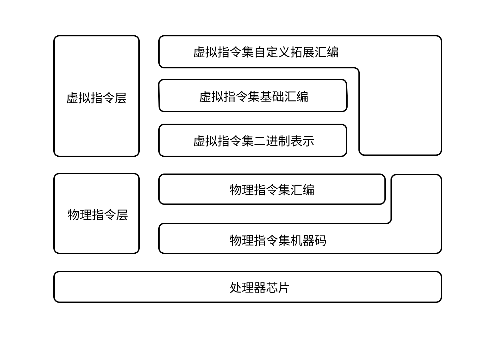
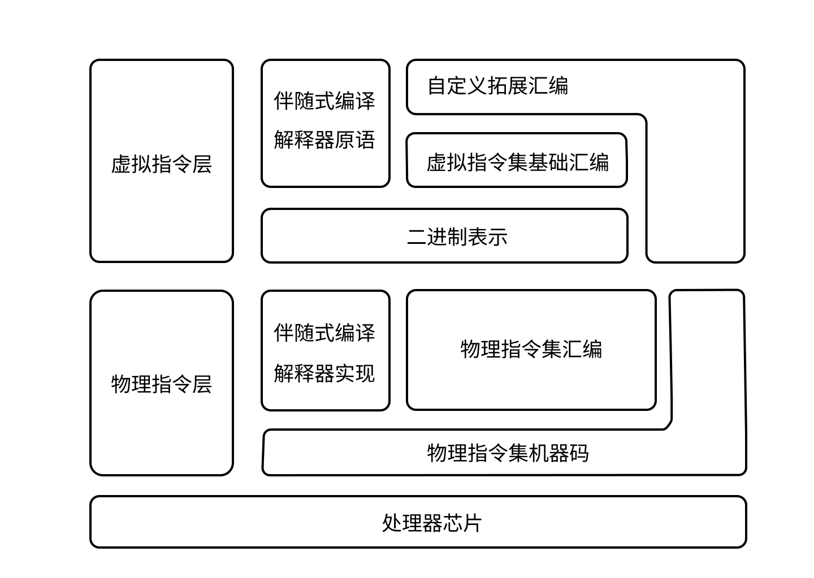
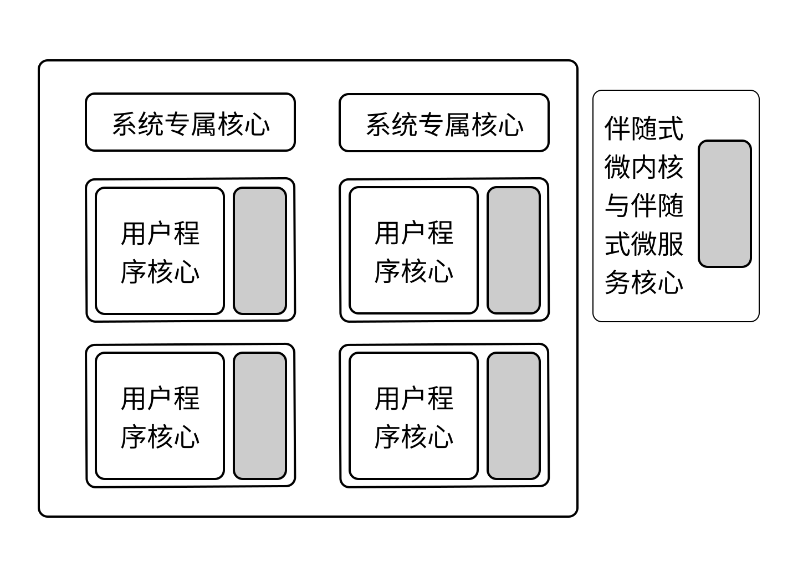

# Two-Level CPU-GPGPU Integrated Instruction Set: Vacuum

## Introduction
This project serves as the specification and manual for **Vacuum**, a two-level integrated instruction set for CPUs and GPGPUs. A two-level instruction set is a design philosophy for Instruction Set Architectures (ISAs), applicable to both GPGPU and CPU ISA design. The world’s most renowned two-level ISA—NVIDIA’s PTX/SASS—is a GPU-only instruction set. However, two-level instruction sets can achieve far more: a single two-level instruction set can function as both a CPU and GPGPU ISA at the architectural level. This is a feat rarely achievable with traditional single-abstraction-layer instruction sets, and it is precisely what Vacuum accomplishes.

### Update Notes
This project is maintained by enthusiasts and updated irregularly. It is currently under development and not yet ready for formal deployment.

### Open Source License
This project is licensed under **CC BY-ND 4.0** (see the LICENSE file for details). It has three core provisions:
1. Must retain the original author's attribution information;
2. Prohibits modification, adaptation, or derivation of the core specifications of this instruction set (including but not limited to instruction definitions, register structures, operation codes, etc.);
3. Permits free use, reproduction, and distribution of this specification (for both commercial and non-commercial purposes), but prohibits the creation of derivative versions based on this specification.

In other words, as an open-source specification, the Vacuum instruction set allows free use by developers but prohibits unauthorized modifications. This design aims to maintain ecological unity. This project only covers manuals and specifications; any work involving specific implementations (e.g., code) will be hosted in separate open-source projects, which typically adopt more permissive licenses such as MIT.

### Git Project Structure
#### Instruction Set Specifications
All implementations and specifications are stored in the `spec` directory.

#### Manuals
All relevant manuals are stored in the `docs` directory.

#### Images
Images used in the markdown documents of manuals and explanations are stored in the `graph` directory.

## Project Preface: What is a Two-Level ISA System, and Why Adopt It?
Like CPUs, GPGPUs are digital circuits that perform computations by executing binary instructions and thus require specific instruction sets. NVIDIA, the dominant player in the GPU market, uses an instruction set system with a unique, prominent, yet rarely discussed feature: it has a **two-level structure**.

These two levels are **PTX** and **SASS**. In daily CUDA development, kernels and `__device__` functions are first compiled into PTX assembly. However, NVIDIA devices cannot execute PTX directly—they only run SASS natively. The device driver and compiler convert PTX to SASS at an indeterminate time: this conversion may occur during distribution, installation, or runtime.

PTX is publicly available with detailed instruction set manuals, while SASS remains a semi-confidential secret of NVIDIA. Although PTX receives version updates, these are mostly minor tweaks, ensuring overall stability. In contrast, SASS can evolve flexibly. Before defining the core concept of "two-level instruction set" (the focus of this project), let us first examine the advantages of NVIDIA’s PTX/SASS design.

### Advantages of the PTX/SASS System
The benefits are evident: an ISA acts as the interface between hardware and software, requiring optimization to meet both upper-layer software requirements and lower-layer hardware constraints. A well-designed ISA should not only be easy to implement, high-performance, scalable, and flexible for hardware but also ensure versatility, compatibility, and usability for software. However, these two sets of requirements often conflict. The two-level instruction set serves as a "silver bullet" to alleviate this conflict.

Below are concrete examples illustrating this conflict and how two-level instruction sets resolve it.

#### Issues Arising from Versatility Requirements
We first use a hypothetical scenario to illustrate conflicts caused by versatility demands. Imagine you are launching a server CPU, targeting two main user groups: 1) Internet companies (for backend servers) and 2) research institutions (for supercomputers). Naturally, additional floating-point features (e.g., double-precision floating-point elementary functions) would appeal to the latter, while string processing instructions or decimal arithmetic would benefit the former. Should you include both sets of features in your product? (Note: If you add a feature to the processor, you must provide corresponding instructions in the ISA—otherwise, software cannot utilize the hardware. Conversely, if the ISA defines an instruction, the hardware must implement the corresponding feature.) You have three options:
1. **Include both**: Support both feature sets in the ISA and hardware. The drawback is significantly increased chip area, as each user group will only utilize a subset of the extra features.
2. **Include neither**: Provide only a minimal ISA and basic CPU functions. This maximizes versatility and simplicity but results in lower performance than competitors’ products for specialized tasks.
3. **Fragment the ISA**: Offer multiple ISAs and chip variants. This avoids wasted chip area and ensures high performance but fragments the ISA ecosystem, complicating upper-layer software development.

We refer to these three options as "all-inclusive," "minimalist," and "fragmented ISA," respectively.

Conflicts from versatility requirements are not limited to hypothetical scenarios—they exist in reality. For example, server GPGPUs and gaming GPUs differ significantly: the former requires high double-precision computing power, while the latter includes specialized graphics modules. For manufacturers active in both markets, the "all-inclusive," "minimalist," and "fragmented ISA" options all have flaws. However, the PTX/SASS system elegantly avoids this dilemma.

A two-level instruction set allows two distinct microarchitectures and lower-level ISAs for these two GPU product lines—while sharing a unified upper-level ISA. The upper-level ISA includes both graphics-related instructions and double-precision floating-point instructions. When the upper-level ISA runs on a target device:
- If the device has a double-precision module, upper-level double-precision instructions are translated to lower-level double-precision instructions;
- If not, the same functionality is implemented using a series of general-purpose integer instructions.

This ensures full functionality of the upper-level ISA and maintains a unified ecosystem—resolving all conflicts.

#### Issues Arising from Compatibility Requirements
Next, we address conflicts caused by compatibility—a common challenge in CPU ISAs, stemming from multiple factors:
1. **Evolving semiconductor manufacturing**: Optimal hardware designs vary across process nodes. For example, CISC instructions were once designed to use memory addresses as operands to save registers—reasonable in the early days of integrated circuits, when CPUs had only a few thousand transistors and memory access latency was comparable to internal computation latency. Variable instruction lengths also saved valuable instruction memory. However, in the era of superscalar microarchitectures:
   - Fixed-length instructions simplify alignment and decoding;
   - Using memory addresses as operands prevents register renaming, severely hindering instruction-level parallelism (ILP).
   Past optimal designs have become burdens today.
   
2. **Transition to 64-bit**: For 64-bit CPUs, supporting 32-bit programs offers no performance benefits but incurs costs in area, power consumption, and even performance. However, obsolete ISA designs cannot be discarded—doing so would abandon the existing ISA ecosystem, as demonstrated by the failure of IA-64. Today, all mainstream commercial CPU ISAs contain legacy components that harm performance but are retained for compatibility.

Given that microarchitecture knowledge evolves continuously, no ISA can remain "performance-optimal" forever. Trade-offs between implementation simplicity, performance, and forward compatibility are inevitable. Every chip designer dreads the "legacy baggage" in ISAs, but little can be done to eliminate it.

For two-level instruction sets, however, this problem is nearly non-existent: the lower-level ISA (executed by hardware) is not the software interface and can evolve freely according to hardware designers’ needs. Only the upper-level ISA needs to maintain forward compatibility—even adding new features will not break compatibility with older programs. Importantly, performance is determined by the lower-level ISA, so a suboptimal upper-level ISA does not affect hardware performance, power consumption, or complexity.

#### Migration and Ecosystem Fragmentation Caused by Vendor-Specific Instructions
While this is not a problem faced by PTX/SASS, two-level instruction sets provide a solution for it.

If multiple vendors share an ISA, any ambitious chip designer will seek to add proprietary instructions. While such customizations may boost performance for specific scenarios, they fragment the ecosystem and hinder portability—creating conflicts similar to those caused by compatibility requirements.

A two-level instruction set resolves this by:
- Fixing a set of basic instructions in the upper-level ISA;
- Requiring vendors (e.g., Vendor A) to provide implementations of their custom upper-level instructions using basic instructions at the start of their programs.

This allows other vendors to run Vendor A’s programs (with custom upper-level instructions) without modifying their compilers or lower-level ISAs. For Vendor A, custom instructions can be directly implemented in the lower-level ISA and hardware—preserving both ecosystem unity and flexibility.

### Preliminary Definition of a Two-Level Instruction Set
Broadly speaking, an instruction set architecture consisting of a two-level system (like NVIDIA’s PTX/SASS, which pairs a virtual instruction set with a physical instruction set) is a **two-level instruction set architecture**. Similar two-level systems exist in other contexts:
- x86 and its micro-operations (micro-ops);
- Java bytecode and target ISAs;
- LLVM IR and specific ISAs.

While these examples resemble two-level structures, they differ significantly from PTX/SASS:

1. **x86 to micro-ops**: The translation is hardware-driven, consuming significant chip area and complexity while harming performance. It is a "necessary compromise" to maintain compatibility with legacy CISC instructions (which are too complex to execute efficiently without being split into micro-ops). In contrast, PTX-to-SASS conversion is an **active division of labor**: the upper level preserves the ecosystem, while the lower level pursues hardware limits. The former is a "compatibility-driven patch," while the latter is a "deliberately designed collaboration"—creating a fundamental difference in the value of hardware complexity (x86’s decoding area is a burden, while NVIDIA’s compiler + driver conversion logic is a competitive advantage).

2. **Java bytecode**: It acts as a programming language middleware rather than part of the system architecture.

3. **LLVM IR to ISAs**: This is closer to PTX/SASS—NVIDIA even uses LLVM as an analogy to explain PTX. However, a core difference remains: PTX/SASS are **co-designed as part of the same architecture**. When NVIDIA designs SASS for a new architecture (e.g., Ampere’s tensor cores), it synchronously extends the PTX interface (e.g., adding `mma` instructions in PTX and hardware-accelerating them in SASS). In contrast, LLVM IR and target ISAs have a **one-way adaptation** relationship: LLVM does not modify its IR to accommodate new CPU ISAs, and CPU vendors do not adjust their ISAs to fit LLVM’s features. This "bidirectional collaboration vs. one-way adaptation" gap leads to flexibility differences: Replacing an ISA under LLVM incurs non-trivial costs, while SASS can be redesigned every generation with minimal overhead. The root cause lies in positioning: LLVM IR is a "compiler intermediate representation" designed to "adapt to all ISAs," not "serve a single ISA"; PTX is designed to "serve SASS"—even its existence enables SASS to evolve freely. Thus, LLVM’s flexibility is "compatibility with existing ISAs," while SASS’s flexibility is "enabling new ISAs."

<figure>
  
  <figcaption>Figure 1: Original Structure of the Two-Level Instruction Set System Architecture.</figcaption>
</figure>

Building on the above discussion, we can propose a preliminary definition: A two-level instruction set system is an actively designed, collaborative framework consisting of an **upper-level virtual instruction set** and a set of **lower-level physical instruction sets**. The virtual instruction set handles software-side requirements (versatility, compatibility), while the physical instruction set is optimized for hardware implementation (high performance). Through this division of labor, the system maintains compatibility and versatility while allowing flexible hardware modifications to achieve generational optimizations or specialization for narrow scenarios.

While this definition is reasonable, designing a two-level instruction set for CPUs presents inherent challenges—requiring new components to be added to the system and leading to a revised understanding and definition of two-level instruction sets.

## Two-Level Instruction Set System Designed for CPUs
### Companion Compiler-Interpreter and Its Primitives
All two-level instruction set systems face a core challenge: converting the virtual instruction set to the physical instruction set. This conversion can occur during distribution, installation, or runtime; runtime interpretation is inefficient, and distribution-time compilation cannot adapt to diverse lower-level ISAs. These two methods can only serve as supplements. Installation-time compilation appears to be the optimal balance of simplicity and performance—and works well for GPU systems (where the driver handles all conversion). However, pure installation-time compilation creates additional problems for CPUs running two-level instruction sets.

Many programs on von Neumann architecture CPUs modify themselves at runtime—these are called **self-modifying programs** (e.g., security encryption software, language runtime compilers). While self-modifying programs are not numerous, their self-modification capability is often irreplaceable. Thus, two-level instruction sets must support such behavior.

Suppose a self-modifying program runs on a two-level instruction set system. Its ability to modify itself depends on support from the system. If virtual-to-physical conversion is forced to occur once during installation:
- Modifying the virtual instruction layer will not enable true runtime self-modification;
- If the OS does not allow writes to the program segment, the program loses all ability to modify itself at runtime;
- If the OS does not protect the code segment, the program can modify the physical instruction layer to achieve self-modification—but this violates the two-level system’s design principles. Virtual and physical instructions have a one-to-many relationship, and physical instructions evolve over time. To run on hardware with different physical ISAs, the program would need to adapt to each one—incurring enormous, never-ending workloads. Without such adaptations, it can only run on a limited range of hardware.

To address this, the system must provide interfaces for self-modifying programs to modify their virtual instructions and achieve runtime self-modification. These interfaces are part of the virtual instruction set. After modifying itself via the virtual instruction set, the program can choose between:
- **Interpretation**: "Trading efficiency for flexibility and startup speed";
- **Just-In-Time (JIT) compilation**: "Trading startup speed and memory for long-term efficiency."

Both methods are necessary and require support from the virtual instruction set, which must expose interfaces for self-modifying programs to invoke.

We define the software responsible for runtime compilation, installation-time compilation, and interpretation of two-level instruction set programs on the client machine as the **companion compiler-interpreter** (the term "companion" emphasizes that it is an integral part of the two-level instruction set system). Each new physical instruction set requires a new companion compiler-interpreter—making this a core task for physical ISA development teams. On the client system, the companion compiler-interpreter runs on hardware and is thus a program executed via the physical instruction set. As noted earlier, its (compatibility-preserving) interfaces are exposed at the virtual instruction layer to support calls from self-modifying programs.

For this reason, the companion compiler-interpreter must be integrated into two-level instruction set systems designed for CPUs. While most programs rely on efficient installation-time compilation, the companion compiler-interpreter is essential for CPU-based two-level systems.

Technically, this design is not inherently difficult—LLVM, for example, includes similar mechanisms. In theory, it is a pure engineering task: adapting LLVM-like technologies to the companion compiler-interpreter. In practice, however, this is one of the most sophisticated and challenging aspects of two-level instruction sets. The Vacuum instruction set includes its own companion compiler-interpreter.

<figure>
  
  <figcaption>Figure 2: Two-Level Instruction Set System with a Companion Compiler-Interpreter.</figcaption>
</figure>

### Companion Microkernel and Its Primitives
CPUs and GPGPUs differ fundamentally: no matter how advanced a GPGPU is, it remains an I/O device—i.e., a CPU subordinate controlled by drivers running on the CPU. For GPGPUs, all functions of the intermediate-layer compiler-interpreter can be delegated to the driver (written in a high-level language, distributed as a binary, and executed by the CPU). For CPUs, however, the "driver" has another name: the **operating system** (OS). It is reasonable to assume that an OS running on a two-level instruction set architecture is primarily written in the virtual instruction set.

This raises a problem: Core OS kernel functions (e.g., memory virtualization, scheduling) cannot be implemented purely in software—they require hardware support, typically via **privileged instructions**. For example, mainstream memory virtualization uses segmentation and paging; to efficiently translate virtual addresses to physical addresses, the CPU must provide TLB caches and corresponding instructions to control them. We refer to such instructions (for CPU-OS collaboration) as **OS-oriented instructions**. How should these instructions be integrated into a two-level instruction set system? In other words, how do two-level instruction sets collaborate with the OS?

First, assume this interaction occurs via privileged instructions. OS vendors will inevitably demand that these instructions be defined and fixed at the virtual layer. Otherwise, they would need to modify the kernel for every processor with a different (physical) privileged instruction set—creating a dilemma similar to that faced by self-modifying programs and violating the two-level system’s core goal: maintaining perfect versatility, compatibility, and portability.

Conversely, fixing OS-oriented virtual-layer privileged instructions also has drawbacks: it locks the interaction method between the processor and OS, restricting the evolution of both. OS development is an independent field, and architecture designers cannot reliably predict future OS requirements. Fixing a single interaction method would fail to maintain optimality across generations or scenarios—violating another core goal of two-level instruction sets: enabling harmless hardware modifications.

The root cause is this: Virtual instructions should define **functions**, while physical instructions determine **implementations**. However, OS-oriented privileged instructions inherently relate to implementations and cannot be easily fixed at the virtual layer. Two solutions exist:
1. **Conservative approach**: Abandon the two-level design philosophy for OS interaction/privileged instructions. Define privileged instructions at the virtual layer and update them gradually with versions.
2. **Radical approach**: Add a new component to the two-level system: the **companion microkernel** and its interfaces (the term "companion" indicates it is integral to the system).

The companion microkernel provides functional interfaces at the virtual instruction layer:
- Some are directly callable by user programs (e.g., `malloc`/`free` for heap memory management, synchronization primitives like `barrier` and `lock`);
- Others interact with privileged software (the upper-level OS, e.g., `fork` for process management).

The physical layer implements these interfaces. The virtual instruction layer does not prescribe OS implementation details (e.g., how virtual memory is mapped to physical memory, or how threads are scheduled). This design maintains upper-layer compatibility while allowing flexible lower-layer modifications. However, the companion microkernel inevitably defines core concepts (e.g., virtual/physical memory, threads/processes)—which are difficult to revise once established. Fortunately, these concepts are likely to remain relevant for a long time.

The companion microkernel’s interfaces should only cover OS functions requiring deep hardware-software interaction. Purely software-implementable operations should be left to OS vendors. Thus, the microkernel is designed to be as minimal as possible (though it may not strictly adhere to the academic definition of a "microkernel").

This approach is a double-edged sword for OS vendors:
- **Advantage**: If a vendor develops a new OS for the two-level instruction set, the burden of kernel development shifts to the two-level instruction set provider.
- **Disadvantage**: Porting an existing OS (e.g., Linux) to a two-level system with a companion microkernel is extremely challenging. It requires disabling conflicting kernel functions and resolving potential conflicts—incurring enormous workloads (or reworking the existing OS into a companion microkernel implementation). In practice, porting legacy OSes to Vacuum is likely impossible due to logical conflicts. The only feasible approach is to make the companion microkernel support POSIX interfaces and maximize compatibility with user-space code from traditional OSes.

The companion microkernel may also improve performance for user programs and OS services. For example:
- **Cache addressing**: Four mainstream methods exist: (1) virtual tag, virtual index; (2) physical tag, virtual index; (3) virtual tag, physical index; (4) physical tag, physical index. Theoretically, method (1) is the simplest and highest-performance but faces aliasing issues (hardware solutions for aliasing harm performance). Thus, method (2) is mainstream today. With a companion microkernel, processor designers can prohibit in-process aliasing via a controllable OS and adopt method (1) for optimal performance (or revert to method (2) if preferred).
- **High-frequency OS functions**: For performance-critical OS functions (e.g., `malloc`/`free` for heap management), the physical-layer implementation of the companion microkernel is provided by the hardware team. Hardware-software co-design can boost performance—for example, attaching a specialized small core to each user core to run the companion microkernel and handle these system functions via inter-core communication. (The author’s long-term vision is to make `malloc`/`free` on Vacuum match the performance of user-defined memory pools across most scenarios.) Traditional OS vendors rarely use hardware-software co-design to improve performance due to upstream-downstream division of labor.

The companion microkernel should provide security-related interfaces at the virtual instruction layer, but their implementation is solely the responsibility of physical-layer and hardware designers. Highly collaborative hardware-software design raises the upper bound of security but also concentrates trust in a single "security black box" provided by the implementer. Users must understand this trade-off and choose trusted implementation vendors.

Additionally, OSes often face the dilemma of competing with user programs for resources: more powerful OS functions consume more hardware runtime. For advanced large-scale CPUs, dedicating small cores to OS tasks is a potential solution. Single-core performance is the most costly resource in digital integrated circuits—doubling transistor count (e.g., increasing issue width from 4 to 6, doubling cache size, or expanding branch predictor caches) typically yields only a 20–30% performance gain. Given the wide variation in core sizes, dedicating small cores to the OS to free up user resources may be cost-effective. Vacuum does not mandate this approach but provides virtual-layer support for it.

The Vacuum instruction set includes its own companion microkernel. The radical approach was chosen not only to maintain design integrity but also to lay the groundwork for the "ambidextrous" implementation discussed below.

<figure>
  
  <figcaption>Figure 3: Two-Level Instruction Set System with a Companion Compiler-Interpreter and Companion Microkernel.</figcaption>
</figure>

We can briefly evaluate OS design on a two-level instruction set with a companion software stack:
- The companion compiler-interpreter assumes most functions of traditional linkers and loaders.
- The companion microkernel handles OS-processor interaction tasks and memory allocation, including:
  - Memory virtualization;
  - Process/thread creation and management;
  - Multi-core scheduling;
  - Synchronization;
  - Exceptions and interrupts.

The remaining functions for the upper-level OS include:
- **Shell**: User interaction interface;
- **File systems** (e.g., ext2, FAT, tmpfs): For persistent storage and program loading;
- **Device drivers** (e.g., for disks, keyboards, displays, UARTs): For external interaction;
- **Standard I/O interfaces** (e.g., implementing `read`/`write` system calls);
- **Self-loading mechanisms**.

In other words, the OS is split into two parts based on "depth of processor interaction." We refer to these as the **upper-level OS** and the **companion software stack**. Vacuum specifies that the OS running on it has three layers: two belong to the upper-level OS (a middle layer for managing I/O, file systems, and buses; a user layer for interacting with users) and one for the companion software stack. This specification also defines the system’s privilege level mechanism:
- The user layer has privileges similar to user programs;
- The microkernel has the highest privilege level;
- Root privileges can be assigned to either the middle layer or the microkernel layer;
- Some functions of the companion software stack and middle layer run at reduced privilege levels.

### Companion Microservices
Compiler and programming language designers often face dilemmas—e.g., designing efficient garbage collectors (GCs) or high-performance interpreters. No software-only "silver bullet" exists for these problems, but hardware can provide support. For example, some designers have attempted to implement hardware-based JVMs to reduce Java interpreter overhead. While effective, such designs are too specialized for commercial viability. Two-level instruction sets offer a solution: **companion microservices** (resident in cores and executed in parallel with user programs on the same core). Vacuum’s hardware-software co-designed prefetcher is an example of a companion microservice.

<figure>
  
  <figcaption>Figure 4: Schematic of a Potential Chip Running a Two-Level Instruction Set.</figcaption>
</figure>

## Ambidextrous Two-Level Instruction Set System for CPUs and GPGPUs
Multi-core CPUs and GPGPUs are perhaps the two most important types of hardware in digital integrated circuits. While they differ "geometrically," they are "topologically similar": both are instruction-driven architectures with decoders, registers, execution units, on-chip cache hierarchies, and on-chip networks. This raises a question: Can we design a virtual instruction set that can be selectively implemented as either a CPU or GPGPU via different physical instruction sets and hardware designs? Such a two-level instruction set is called an **ambidextrous two-level instruction set**.

Vacuum achieves ambidexterity using three components:
1. Predicated vector instructions;
2. Thread clusters;
3. Thread cluster private memory domains.

By varying hardware support for these components (predicated vector instructions, threads, and thread private memory domains), Vacuum can be designed into either a CPU or GPGPU. We propose a new name for processors executing Vacuum: **IPU (Instruction Processing Unit)**.

### Predicated Vector Instructions
A GPGPU’s core function is to accelerate tasks with "single instruction, multiple data" (SIMD) parallelism. However, GPGPUs implement this differently: NVIDIA uses the "single instruction, multiple threads" (SIMT) paradigm (with Cooperative Thread Arrays, CTAs), while AMD relies on **predicated vector instructions** (also called SIMD, distinct from the parallelism feature). CPUs also support predicated SIMD, but typically via fixed-width registers; GPGPUs, by contrast, specify the number of elements operated on simultaneously.

Vacuum’s SIMD instructions follow the GPGPU style: the width (number of elements operated on simultaneously) is not fixed but must be 4 multiplied by a positive integer power of 2 (or zero) and cannot exceed the machine word length. For example, on a 64-bit machine, allowed widths are 0, 8, 16, 32, and 64. Vacuum provides primitives to query this width and its exponent.

### Thread Clusters
All instruction-driven hardware faces a challenge: How to fill its pipeline with enough instructions? Modern high-performance CPUs use out-of-order superscalar designs, while GPGPUs rely on multiple program counters (PCs) working in tandem. CPUs can achieve similar results via Simultaneous Multithreading (SMT, commonly called "hyper-threading"). The apparent difference is that GPGPUs typically have more PCs per core (or Streaming Multiprocessor/SM, Compute Unit/CU), but the fundamental ISA-level difference is this: On GPGPUs, threads (or PCs) residing on the same core (SM/CU) can be explicitly controlled and coordinated by user programs.

Vacuum’s companion OS introduces the concept of **thread clusters**—groups of threads that run on the same processor core and are scheduled as a unit by the OS. Key parameters include:
- **Cluster width**: The number of threads in a thread cluster.
- **Cluster capacity**: The maximum number of threads in a thread cluster that a single core can run simultaneously. It must be a positive integer power of 2 (or 1) and cannot exceed the machine word length. For example, on a 64-bit machine, allowed capacities are 1, 2, 4, 8, 16, 32, and 64.

Vacuum provides primitives to query the cluster capacity and its exponent. For any machine, the cluster width of user-launched thread clusters must be less than the cluster capacity and a power of 2. For example, if a physical ISA has a cluster capacity of 8 (a core can hold 8 threads simultaneously), user thread clusters can have 1, 2, 4, or 8 threads. On a GPGPU-style IPU, the cluster capacity may be as high as 64; on a CPU-style IPU optimized for single-core performance, the cluster capacity may be 1 or 2.

Vacuum provides dedicated intra-cluster synchronization primitives with lower overhead than inter-thread or inter-cluster synchronization. On CPU-style hardware, users can also explicitly use thread clusters to accelerate tasks with limited data-level parallelism. Even when thread clusters are not explicitly used, each core can still run `N` independent threads (where `N` equals the cluster capacity)—avoiding significant hardware waste.

In Vacuum, a single thread not in a cluster is equivalent to a cluster with a width of 1 (called a **normal thread**). Clusters with a width equal to the cluster capacity are called **default-width clusters**. Normal threads and default-width clusters are referred to as **preferred clusters**. The author recommends that developers set thread cluster widths to the cluster capacity (default width) and manually partition tasks accordingly; otherwise, normal threads should be used. Other cluster widths are not recommended for general use.

Thread clusters are not the only way to achieve ambidexterity—alternatives include asymmetric main-slave thread groups on a single core (to prioritize main-thread performance). This was Vacuum’s initial design but was abandoned due to poor programming model simplicity and CPU-GPU compatibility. Thread clusters were chosen because setting their width and capacity to 1 mimics the main-slave design.

### Thread Cluster Private Memory Domains
In addition to on-chip caches, GPGPUs include programmer-accessible on-chip memory (e.g., NVIDIA’s shared memory—physically identical to L1 cache—and AMD’s Local Data Store/GDS, Global Data Store). Vacuum’s companion microkernel allows threads to allocate **thread cluster private memory domains**—specialized memory regions:
- On GPU-style hardware, this region can be mapped to dedicated hardware (functioning like shared memory);
- On CPU-style hardware, accessing this region may be identical to accessing stack memory (accelerated via the on-chip cache hierarchy without specialized hardware).

CPU-style programs can ignore this concept entirely, and CPU-style IPUs incur no additional transistor costs for this memory domain.

### Ambidexterity and Performance
Ambidexterity delivers enormous value for programming usability, versatility, and ecosystem unity. It does **not** require designing a "unified CPU-GPU core" that excels at both parallel computing and complex serial logic (though such designs are not prohibited). Hardware designers will typically choose to build either a GPU-style IPU (optimized for data-level parallelism) or a CPU-style IPU (optimized for complex logical tasks).

Running a complex logical task on a GPU-style IPU does not guarantee speed, but ambidexterity ensures it will run correctly to completion—consistent with the core goal of two-level designs: maintaining a unified ecosystem while allowing diverse hardware implementations. These specialized hardware variants are optimized for specific task categories; running non-target programs on them may yield low performance. Developers must be aware of this and anticipate suboptimal performance when using mismatched hardware (even under the same PTX or x86 ISA, hardware capabilities vary drastically. Has performance portability ever been achieved under a unified software ecosystem? In fact, performance portability is theoretically unachievable—unified ecosystems are the practical limit). Additionally, developers must recognize that automatic parallelization and vectorization remain challenging for current compilers; the responsibility for exploiting task parallelism still lies with programmers. This lack of guaranteed performance portability does not negate the value of ecosystem unity.

Will ambidexterity constrain hardware performance if designers aim for a pure GPU-style or CPU-style IPU? The author推测 (speculates) that its impact—positive or negative—is minimal. For example:
- A pure CPU-style processor can be created by setting the cluster capacity to 1, SIMD width to 0, and configuring the companion compiler-interpreter to nullify intra-cluster synchronization interfaces and remove their calls. Compared to traditional ISAs, this imposes no additional restrictive constraints (e.g., strong sequential consistency—weaker upper-layer consistency can be strengthened at the lower layer, but stronger upper-layer consistency cannot be weakened). Since the virtual layer only defines behavior and the physical layer determines implementation and performance, the virtual layer itself has no significant negative impact on performance.
- For a GPU-style IPU, key parameters can follow industry-standard defaults. GPGPU-style synchronization operations are replicated to match common designs, and even specialized memory domains can be implemented via Vacuum’s powerful customization features. Its most distinctive feature is abandoning SIMT’s warp-level multithreading in favor of requiring processors to have basic scalar capabilities and scalar register storage (with size determined by hardware vendors’ investment). This benefits many tasks.

In final products:
- CPU-style IPUs may include limited SIMD capabilities as secondary features—stronger than traditional CPU SIMD but far inferior to traditional GPGPs in area efficiency and memory bandwidth.
- GPU-style IPUs can function as CPUs with numerous cores (each with weak serial capabilities) and may excel in scenarios traditionally dominated by CPUs (e.g., databases).

# Additional Topics
## Physical Instruction Set Asymmetric Multiprocessing Systems
Many commercial CPUs include integrated GPUs (iGPUs). As an ambidextrous instruction set, Vacuum enables chips where both CPU and GPU cores support Vacuum—though their physical ISAs may differ. Additionally, if a pure CPU-style or GPU-style IPU dedicates small cores to OS tasks, these small cores may use a different physical ISA than user-program cores. This poses new challenges for the companion compiler-interpreter, companion OS, and virtual instruction set itself.

## Physical Instruction Layer Designed for CPUs
By breaking free from versatility constraints, two-level instruction sets facilitate the implementation and commercialization of **narrow-versatility CPUs** (optimized for specific workloads). However, CPUs derive their commercial value from versatility; the author believes narrow-versatility CPUs will struggle to dominate the market in the current era and will not be a focus in early development. Additionally, by breaking compatibility constraints, two-level systems unlock performance for versatile CPUs (with additional gains from the companion microkernel). However, designing a physical ISA and corresponding microarchitecture to maximize this performance gain is a non-trivial topic—the extent of this gain will determine the commercial viability of two-level instruction sets.

Numerous explicit parallel ISAs and design philosophies exist (e.g., VLIW). These can serve as physical ISAs in two-level systems, and two-level designs can mitigate their major flaw: poor compatibility. However, explicit parallel ISAs and their microarchitectures have historically lost the "single-core performance race"—the lack of runtime information limits their ability to exploit instruction-level parallelism (ILP). The author believes such ISAs may be preferred for area-efficient scenarios but cannot serve as primary physical ISAs.

Finding a physical ISA (and microarchitecture) capable of pushing single-core performance limits for two-level systems is a significant challenge. Drawing inspiration from existing out-of-order superscalar microarchitectures, the author proposes the **Split-Path Control-Flow Graph Instruction Set** (referred to as the **Split-Path ISA** for short)—a specialized ISA for out-of-order superscalar microarchitectures with branch prediction. Put simply, it is an "ISA tailored for superscalar microarchitectures." It takes a middle ground between explicit parallel and out-of-order superscalar microarchitectures: like out-of-order processors, it relies on hardware dynamic scheduling (retaining ILP potential); unlike them, its ISA provides unique support for microarchitectural behaviors such as register renaming, branch prediction, and multi-issue. It represents a "collaborative approach" (software assisting hardware) rather than full reliance on software or hardware—aiming to achieve wide-issue, short-pipeline, and small-footprint superscalar microarchitectures (wide = large issue width, short = few pipeline/logic stages, small = minimal area and power).

Documenting this ISA and its microarchitecture will require a separate project, with no clear timeline. However, its conceptual feasibility gives the author confidence in Vacuum—at minimum, Vacuum’s design philosophy can potentially improve single-core performance and power efficiency for versatile CPUs. Below is a brief overview of its key features.

[fluct]
https://gitee.com/hao-yiping/fluctu

### Split-Path Control-Flow Graph Instruction Set
Note: This is a brief introduction; actual implementations may be more complex. In general, it introduces more changes to the frontend than the backend—though the backend also includes new mechanisms (e.g., fast operation fusion, large hierarchical L1 caches, software-guided hardware prefetchers) that do not alter its core structure.

#### Instruction Virtual Pages and Instruction Packets
All instructions of a program are organized into **instruction virtual pages**, with sizes that must be powers of 2 (tentatively set to 4 kB). The start address of each instruction virtual page in virtual memory must be aligned to 4 kB (i.e., the remainder when divided by 4 kB is 0). Instruction virtual pages resemble OS memory paging but are independent concepts: the former is part of the processor architecture, while the latter is an OS concept. Instruction virtual pages do not require OS memory virtualization—for example:
- If a paged OS uses 8 kB pages, two instruction virtual pages can be placed in one OS page.
- For a segmented OS, instruction virtual pages can be placed in segments as long as their start addresses meet alignment requirements.

Instructions within an instruction virtual page are organized into **instruction packets**, typically sized to match cache lines (with instruction virtual page sizes that are integer multiples of packet sizes). Assuming a 64 B cache line, a 4 kB instruction virtual page can hold 64 instruction packets. Instruction packets are aligned by their own length.

#### Split-Path Control-Flow Graph Instruction Set
Traditional ISAs include two types of instructions:
1. **Control-flow instructions**: Involve PC jumps (relative/absolute jumps, conditional/unconditional branches) and may jump to addresses far from the current PC.
2. **Computation instructions**: Involve memory access and computation. If no exceptions occur, the PC increments linearly by the instruction length after execution.

In traditional ISAs, control-flow and computation instructions are interleaved. The Split-Path ISA differs: it separates and groups control-flow and computation instructions within each instruction virtual page. Control-flow instructions occupy the lower-address region, while computation instructions occupy the higher-address region. Key rules include:
- Each control-flow packet contains 8 control-flow instructions.
- Each computation packet contains 16 computation instructions (12 in some designs).
- Mixing control-flow and computation instructions in a single packet is prohibited.

Consider the control-flow graph (CFG)—a common compiler concept where each node represents a **basic block** (a sequence of code with a single entry, single exit, and no mid-block jumps or incoming jumps). The Split-Path ISA directly maps this CFG: each control-flow instruction has associated computation instructions, and the control-flow instruction executes after its associated computation instructions. The Split-Path ISA sets a maximum limit on the number of computation instructions per control-flow instruction (e.g., 64) and enforces the following rules:
1. All computation instructions associated with a control-flow instruction reside in the same instruction virtual page and occupy consecutive addresses.
2. All computation instructions associated with the 8 control-flow instructions in a single control-flow packet occupy consecutive addresses (to compress instruction information).
3. Instruction packets and virtual pages are for alignment, not padding. Computation instructions in a packet do not need to belong to the same control-flow instruction, and no assumptions are made about their number—each computation instruction can belong to a different control-flow instruction.
4. Like CFGs, control-flow instructions can only jump to other control-flow instructions (not to intermediate computation instructions).
5. Computation instructions can change the execution path via exceptions.
6. Two PCs can be used, or a 64-bit PC can encode the processor’s execution state.
7. There is no minimum number of computation instructions per control-flow instruction (it can be 0 or 1).

The Split-Path design is not the only way to implement an explicit CFG-based ISA.

#### Local Caches for Split-Path ISAs
A distinctive feature of Split-Path ISA microarchitectures is the use of **two physically independent L1 instruction caches** (L1I) at different pipeline stages:
- **L1IF**: Stores control-flow instructions.
- **L1IC**: Stores computation instructions.

The ISA requires **weak memory consistency**, and the microarchitecture requires **weak cache coherence**—stronger models would severely harm performance. Key Split-Path mechanisms rely on these weak protocols.

Under two-level instruction sets, the companion microkernel prohibits in-process physical address aliasing to enable **pure virtual addressing** for L1 caches. Prohibiting in-process aliasing is far less restrictive than prohibiting inter-process aliasing: it minimally impacts user code but significantly hinders some system components. Compared to the mainstream VIPT (Virtual Index, Physical Tag) design for parallel memory access and address translation, VIVT (Virtual Index, Virtual Tag) offers three advantages:
1. **Lower power consumption**: Typical L1 TLBs are 32-way set-associative; parallel lookup/comparison of numerous entries (with most discarded) wastes significant power.
2. **Unconstrained L1 capacity**: Large L1 caches can be implemented with low associativity.
3. **Reduced TLB miss latency**: With lower L2 access latency pressure, L1-L2 TLBs can be significantly larger—mitigating TLB misses for sparse memory accesses.
4. **Support for ambidexterity**: For microarchitectures with paged memory virtualization and ambidexterity, translating 32 or 64 memory requests via TLBs in a single cycle is challenging—VIVT simplifies this.

Another distinctive feature is the **distributed L2 cache capacity** across L1 caches, forming a unique **hierarchical exclusive L1 cache** (more likely Tag-Inclusive, Data-Exclusive). Traditional microarchitectures have much smaller L1 caches than L2 caches (e.g., 32 kB L1D, 1 MB L2). Split-Path microarchitectures reverse this: for example, a 512 kB L1D and 64 kB L2 (or 512 kB L2 shared across 4 cores). Such a large L1D cannot be accessed globally within tight timing constraints, requiring internal hierarchy—e.g., 32 kB L1D1 (2-cycle access), 96 kB L1D2 (3-cycle access), and 384 kB L1D3 (5-cycle access). Higher internal L1 levels prioritize power efficiency and density over latency and bandwidth. This hierarchical design is **data-exclusive**: a cache line hit in a higher level triggers a swap with a cache line in the next lower level. While driven by L1 cache capacity demands, this design does not necessarily harm overall cache performance—each level can be sized to maximize performance within its timing constraints.

This hierarchical L1 design is uniquely suited to systems like Vacuum: traditional microarchitectures require merging local Harvard architectures into a global von Neumann architecture at the L2 level, but Split-Path ISAs can rely on the companion microkernel and specialized instructions for this. Additionally, large inclusive L2 caches aid cache coherence for strong memory consistency ISAs (e.g., SC/TSO)—a requirement Split-Path microarchitectures avoid. Thus, L2 caches can also be exclusive, with capacity distributed into L1 caches to minimize local memory access latency. A compromise is to use a 256–512 kB L2 cache shared across 4 cores (aligning with Vacuum’s "secondary cluster" concept—programmers can launch 4 thread clusters onto a secondary cluster of 4 cores).

L2 caches use **physical addressing (PIPT)**. Address translation occurs between L1 and L2, where looser timing constraints enable larger TLBs.

Due to the separated storage of control-flow and computation instructions (and strict jump/alignment rules), Split-Path ISA microarchitectures can perform **unprecedentedly aggressive pre-decoding** of instructions. Pre-decoders are placed between L1I and L2, increasing L1I capacity requirements. Combined with shorter pipelines and dual L1I caches, this raises L1I timing demands—making hierarchical L1 caches a rigid requirement.

#### Stack Space for Split-Path ISAs
The Split-Path ISA allocates **three independent stack spaces** per thread:
1. **Heap-based stack**: Resembles traditional stacks—visible to programmers and accessed via memory instructions. Unlike traditional stacks, it does not handle register saving or control-flow management (these functions are offloaded to other stacks to simplify hardware and improve performance).
2. **Register save stack**: Invisible to programmers, protected by the OS, and accessed only via hardware (not memory instructions). Aligned to 8 bytes.
3. **Control-flow stack**: Also invisible to programmers, OS-protected, 8-byte aligned, and hardware-accessed.

The main drawback is that small threads require additional virtual/physical pages—wasting some memory.

A small hardware module near L1IF (called the **control-flow stack cache**) caches the control-flow stack. With typical sizes of tens to hundreds of entries, it replaces both the Return Address Stack (RAS) for branch prediction and shadow stacks for control-flow protection. Its addresses are strictly accurate (serving as a local cache for all return addresses), eliminating the need to handle RAS-like 3C (Compulsory, Capacity, Conflict) misses.

A corresponding hardware module in the pipeline backend manages the register save stack, enhancing the latency and bandwidth of register swapping. It typically has tens to 200 entries.

#### Branch Prediction for Split-Path ISAs
Control-flow instructions in the Split-Path ISA occupy 64 bits on average—twice the length of traditional RISC instructions. This extra length is dedicated to **instruction annotations**—special fields storing branch prediction information. Instruction annotations allow hardware to dynamically write branch prediction data into instructions during runtime:
- For immediate-relative conditional branches, annotations store history information (replacing traditional PHT/BHR/CPHT hardware).
- For register-addressed unconditional branches, annotations store predicted jump addresses.

Branch address prediction occurs during pre-decoding: after pre-decoding, jump targets are stored in dedicated fields of pre-decoded instructions. Pre-decoders also precompute target addresses for immediate-relative branches. Thus, information traditionally stored in the BTB (Branch Target Buffer) is integrated into pre-decoded instruction annotations. In short, Split-Path ISA microarchitectures do not require independent branch prediction caches (e.g., BTB)—most are distributed into L1IF.

When cache lines are evicted, updated instruction annotations are written back with the entire cache line. This treats the entire memory hierarchy as a branch prediction cache, which helps mitigate 3C misses but has a major drawback: **low instruction density** (discussed below).

Another key constraint (and disadvantage) is this: Traditional microarchitectures perform PC-based branch prediction—using the PC at the pipeline frontend to access branch prediction caches and predict branches in parallel with fetching. Split-Path microarchitectures cannot do this: branch direction prediction requires (pre-decoded) instruction data. In other words, the pipeline frontend requires both the PC and the corresponding instruction. To avoid pipeline bubbles, this requires branch prediction and instruction fetching to complete serially in one cycle—imposing strict timing constraints. However, this can be resolved with a **lightweight over-fetch mechanism**: during each fetch, the current instruction’s jump target and next sequential instruction are fetched in parallel with branch direction prediction. Since pre-decoded instruction annotations already contain jump target information, the target address is known immediately after reading the pre-decoded instruction (no additional computation is needed). After predicting the branch direction, either the jump target instruction or the next sequential instruction is discarded, and the PC is updated accordingly. The constraint of completing branch direction prediction in one cycle remains.

Requiring instruction data for branch prediction is not entirely negative—it offers two significant benefits:
1. **Parallel frontend operations**: With instruction data available at the frontend, other operations (e.g., fetching associated computation instructions, pushing the control-flow instruction into the control-flow ROB) can be completed in the same cycle. (The "frontend" is more accurately a "central hub" for these operations.)
2. **Compiler-guided prediction**: Compilers can explicitly inform hardware of instruction types (e.g., "loop branch" or "if-else branch"), enabling hardware to apply distinct prediction strategies based on strict categorization (not guesswork). Writing this static information is far easier for compilers than statically predicting branch directions.

For multi-core processors, **annotation conflicts** may occur if different cores execute the same branch instruction. These conflicts can impact performance in three ways:
- **Positive**: If branch behavior is similar across cores and the cache is cold (no existing annotations).
- **Neutral**: If branch behavior is similar across cores and the cache is warm.
- **Negative**: If branch behavior differs across cores and the cache is warm.

Overall, the risks outweigh the benefits. To mitigate this, Split-Path microarchitectures require weak memory consistency and weak cache coherence—ensuring high-frequency, locally cached branch prediction information. Frequent branches remain in local caches, with updates written back to global caches only during eviction. Conflicts thus only affect instructions written back to or fetched from global caches.

In summary, Split-Path microarchitectures use instruction annotations and aggressive pre-decoding to replace large branch prediction caches. Target address prediction is moved from the main pipeline to the pre-decoding stage. Requiring instruction data for branch prediction is both a key constraint and a major advantage—it enables 4–5 critical frontend operations to complete in parallel within one cycle. The frontend has approximately 3 pipeline stages, with the second and third stages overlapping with backend operations—far shorter than traditional out-of-order superscalar processors.

#### Register Renaming for Split-Path ISAs
In traditional out-of-order superscalar microarchitectures, when multiple instructions (e.g., 16) are issued simultaneously, hardware must dynamically check for data dependencies:
1. If instruction A precedes instruction B, check if A’s output is B’s input. If yes, pass A’s destination register to B (instead of the outdated physical register in the rename table).
2. If instruction A precedes instruction B, check if B’s output overwrites A’s output. If yes, do not update the rename table with A’s physical register address; if no, update it. Additionally, if overwriting occurs, subsequent instructions dependent on B must use B’s physical register (not A’s).

Checking all instruction pairs scales quadratically with the number of instructions—becoming a major bottleneck for area, power, and latency as superscalar width increases: 16 instructions require 120 checks (16×15÷2), each with dedicated comparison logic.

The Split-Path ISA imposes constraints to enable **aggressive pre-decoding for register renaming**: Simultaneously issued instructions must belong to the same control-flow instruction. This allows dependency checking for simultaneous instructions to be moved from the main pipeline to the pre-decoding stage. The remaining register renaming logic in the main pipeline has **linear area complexity** and **constant time complexity** (though 2N N-way selectors are still required). This enables large superscalar widths (e.g., 12–16) with minimal overhead and shortens pipeline stages.

The implementation mechanism is as follows: Each packet contains 12–16 bits of compiler-generated static information indicating whether instructions belong to the same control-flow instruction. After pre-decoding, register encodings are extended with an additional flag bit:
- For source operands: A flag of 0 indicates no intra-packet dependencies; a flag of 1 indicates which intra-packet instruction’s result is dependent.
- For destination operands: A flag of 0 indicates the result will not be overwritten by subsequent intra-packet instructions (requiring a logical-to-physical register mapping in the rename table); a flag of 1 indicates overwriting (no mapping needed).

An additional benefit is that register renaming logic for computation instructions does not need to handle control-flow instructions.

If a control-flow instruction has many associated computation instructions, no fundamental issues arise. If it has few (e.g., 4), the instructions may be split between the end of one packet and the start of the next. Simple solutions exist:
1. Use a 1-bit flag to indicate if the first 4 instructions of a packet belong to the same control-flow instruction as the last few instructions of the previous packet. If yes, pre-decode these 4 instructions twice (using different pre-decoded results when issuing two packets simultaneously or the latter packet alone).
2. Bind the two packets together: Cache hits for split instructions require both packets to be cached. Pre-decoding the second packet requires information from the first, but no duplicate pre-decoded results are stored.

A typical Split-Path microarchitecture issuing one control-flow instruction per cycle has an effective superscalar width of ~1+12 (1 control-flow + 12 computation instructions). While impressive, this wastes bandwidth if control-flow instructions have few associated computation instructions (e.g., 4 on average). Fortunately, bandwidth costs are low, and modern superscalar processors support simultaneous processing of multiple control-flow instructions (critical for control-flow-dense tasks). For Split-Path ISAs, handling two control-flow instructions simultaneously is feasible via enhanced over-fetching—but this places heavy pressure on pre-decoding for register renaming, risking a fallback to traditional out-of-order renaming. For control-flow-sparse tasks or designers prioritizing simplicity, Split-Path microarchitectures can process one control-flow instruction per cycle—unlocking an extreme optimization: pre-decoded register renaming results are static information (easily computed at compile time) and can be directly encoded into instructions, eliminating the need for quadratic-complexity pre-decoders.

#### Rough Estimate of Instruction Density
Instruction annotations increase control-flow instruction length to 64 bits (twice that of traditional RISC instructions). Additionally:
- If a computation packet contains 16 instructions (32 bits each), density is similar to RISC.
- If a computation packet contains 12 instructions, each computation instruction is longer than RISC.

These two factors reduce instruction density. The exact reduction depends on the proportion of control-flow instructions (higher proportions = lower density). Assuming a relatively high 25% control-flow instruction ratio:
- For 16 computation instructions per packet: Average instruction length = 5 bytes (25% longer than RISC).
- For 12 computation instructions per packet: Average instruction length = 6 bytes (50% longer than RISC).

Pre-decoding further increases instruction length (≈1 byte for computation instructions, ≈2 bytes for control-flow instructions), reducing L1 instruction cache efficiency to 50–75% of RISC—nearly offsetting the benefits of dual L1I caches. Fortunately, this does not cause severe performance loss, and hierarchical L1 designs may partially compensate with increased capacity. However, it increases overhead for global caches, main memory, and non-volatile storage.

Unlike VLIW, Split-Path ISAs do not require computation instructions in a packet to belong to the same control-flow instruction—avoiding excessive NOPs. However, bubbles still occur:
1. **Instruction virtual pages**: Control-flow instructions and their associated computation instructions must reside in the same virtual page, leading to partially filled packets in most pages.
2. **Compiler optimizations**: Aggressive compiler optimizations may assign computation instructions for hot inner loops to independent packets (with no performance benefit on most microarchitectures).
3. **Function placement**: Compilers may optionally fit all instructions of a function into a single virtual page (again, with no performance benefit on most microarchitectures).

The above estimates are rough, as key factors are unquantified:
- RISC ISAs often include 16-bit compressed instructions.
- Split-Path ISA instructions may have stronger functionality: 64-bit control-flow instructions support jumps to any address and conditional returns; 12-instruction computation packets have longer immediates and 64 general-purpose registers (reducing stack spills and associated instructions).

#### Compiler Support for Split-Path ISAs
What additional work do compilers need to do to support Split-Path ISAs? The author asserts: very little. The ISA only requires compilers to perform tasks they already excel at. The Split-Path ISA’s encoding framework is a direct mapping of CFGs to ISAs—and CFGs are already the primary intermediate representation (IR) used by compilers.

Compiler workflow for Split-Path ISAs:
1. After completing register allocation (graph coloring) and spill handling, map most IR instructions to physical ISA instructions.
2. Split CFG basic blocks into smaller blocks if they exceed the Split-Path ISA’s computation instruction limit per control-flow instruction.
3. Allocate these blocks to instruction virtual pages in order.
4. Translate the blocks to Split-Path instructions and add static annotations.

Required static annotations include:
1. **Branch type**: e.g., "loop branch," "if-else branch," or "loop exit branch." Compilers already perform this analysis; the only addition is encoding it into instructions. The Split-Path ISA does not require compilers to statically predict branch directions—instead, it relies on runtime profiling to write prediction data back to storage via instruction annotations.
2. **Number and address of associated computation instructions**: Explicitly known to the compiler.
3. **Intra-packet dependencies**: For computation packets, indicate if instructions belong to the same control-flow instruction and their dependencies. Belonging is explicit, and dependencies are checked via a packet-level traversal (quadratic in packet length, linear in packet count). With packet lengths ≤20, this is a lightweight, linear-time task for compilers.
4. **Function placement**: Allocating a function to a single virtual page may slightly improve TLB hit rates (already high under VIVT) and reduce immediate lengths (most jumps are intra-page if instructions are ordered naturally). This is an optional optimization, not a requirement.

#### Reflections on Split-Path ISAs
How was the Split-Path ISA designed? The author cannot recall all details, but the core philosophy was to simplify out-of-order superscalar microarchitecture design, reduce hardware complexity, transistor count, and power consumption—while preserving (or at least not sacrificing) performance. After drafting the Split-Path ISA and its microarchitecture, the author formed subjective views on historical ISA evolution—particularly the RISC vs. CISC debate.

When RISC emerged, many believed it was superior to CISC. Over time, CISC evolved to narrow the gap, leading to the consensus that "ISA matters little—microarchitecture is key." However, the author believes the truth is this: ISAs and microarchitectures are deeply interdependent; an efficient computing system requires tight co-design. RISC is a "native ISA" for "scalar microarchitectures with many general-purpose registers." For scalar processors with 1–10 million transistors, RISC is far superior to CISC or other ISAs. However, as single-core transistor counts exceeded 100 million (enabling out-of-order superscalar designs), both CISC and RISC became "non-native" to out-of-order superscalar microarchitectures—both requiring enormous transistor counts to support superscalar designs, thus narrowing performance differences.

Out-of-order superscalar is an extremely important microarchitectural innovation that has dominated general computing for nearly 40 years. Yet the industry never sought an ISA tailored for this microarchitecture—instead, it pursued more radical (and ultimately failed) alternatives like VLIW, explicit parallelism, and dataflow ISAs (which rely heavily on compilers and tooling). In other words, "out-of-order superscalar-specific ISAs" seem to be a missing concept in the industry—assumed to be non-existent, unnecessary, or undesirable. This absence likely led to the consensus that "ISA does not matter." The author believes RISC designers first designed a microarchitecture (with features like multiple general-purpose registers and multi-stage pipelines) and then created an ISA optimized for it—resulting in RISC.

Theoretically, with similar key parameters (e.g., issue width, physical register count, branch prediction accuracy, cache size), a Split-Path ISA microarchitecture should be simpler and require fewer transistors/power than CISC/RISC implementations with comparable performance. However, this remains a vision and estimate without quantitative data. The author is curious to see how small such a microarchitecture can be. If a Split-Path ISA microarchitecture achieves similar performance to traditional ISAs with fewer transistors/power (same process node), the above views hold. Otherwise, the views are incorrect—or the Split-Path ISA is not suitable to be the "out-of-order superscalar-specific ISA."

## Vacuum Instruction Set System-Level Programming Language
Architecture teams focused on CPUs can concentrate on traditional research areas (ISAs, microarchitectures) because the software ecosystem (e.g., Linux, C) is reusable and immutable. Additionally, CPUs have strong versatility—hardware features like register count rarely need to be exposed to upper-layer software. This is not true for GPGPUs or specialized processors.

Thus, Vacuum requires its own system-level programming language. It abandons the "most well-known and successful" strategy of extending C++ and instead adopts a dual-track approach:
1. Design a C language extension to facilitate migration of legacy code.
2. Design a new, independent system-level programming language.

The reason for abandoning C++ extensions is straightforward: developing a compiler frontend for extended C++ requires far more effort—potentially several times that of the two alternative approaches combined. (The author lacks the ability and resources to undertake this; others are welcome to try.) The motivation for choosing a C extension is equally clear: C is foundational, its libraries are widely compatible, and development effort is reasonable.

The motivation for designing a new independent language is to create one fully controlled by Vacuum’s designers—enabling synchronous evolution and deep collaboration with Vacuum to maximize utilization of its features. Development costs are manageable: Vacuum is its only supported IR in the early stages, requiring only a compiler frontend and system library. The system library can reuse C code or rely on an OS running on Vacuum for implementation. Below is an overview of its design philosophy (specific features are not discussed here):
1. **Part of a complex hierarchical architecture**: It is not a testbed for new language concepts. Its core mechanisms draw on proven C/C++ designs, avoiding radical or controversial features. For example, as a system-level language, the author cannot eliminate pointers (or even `void*`).
2. **Not a 1:1 C/C++ clone**: However, C++ programmers should be able to use it immediately after reading the manual.
3. **Ambidextrous, like Vacuum’s virtual layer**: It blurs the line between CPUs and GPGPs at the model/concept level—both are simply IPUs with different hardware parameters.
4. **Runnable on traditional CPUs**: However, it no longer functions as a system-level language on traditional CPUs. Vacuum-specific features must be emulated (with no guarantees of optimal performance or efficiency). Not all traditional CPUs are supported—for example, Vacuum mandates little-endianness, so it will likely not run on big-endian traditional CPUs.
5. **No guarantees for traditional GPUs**: Runability on traditional GPU devices is not guaranteed.
6. **Interoperability with C/C++**: It can build libraries for C/C++ programs running on IPUs and call C/C++ libraries. However, this interoperability may require additional compatibility declaration files (similar to header files) rather than being enabled by default.
7. **Compiler frontend automation**: It should provide syntax-level and standard library-level components corresponding to compiler frontend automation tools, assuming Vacuum as its IR. It will support frontend and interpreter development for various programming languages to run on Vacuum.
8. **LR(1)-level frontend**: Its grammar can be parsed by an LR(1) parser.
9. **Name**: Yac.

[Yet Another C]
https://gitee.com/hao-yiping/YetAnotherC.git

## A Real-World Vacuum Instruction Set Deployment Plan
Most people’s first reaction to Vacuum is shock or skepticism about the enormous workload required for deployment—especially given its enthusiast-led development. Superficially, deployment requires developing numerous new components: specifications for both instruction levels, companion compiler/microkernel software, IR optimizers, a system-level programming language (Yac), etc. Collectively, this seems overwhelming—but the workload for a **minimally functional Vacuum deployment** is far less daunting than it appears. The author explains why:

1. **Component synergy reduces workload**: For example, Vacuum is Yac’s only native IR in the early stages—meaning Yac’s development is complete once its frontend is built. Many standard library functions can be implemented by mapping to companion microkernel interfaces, reducing workload by at least an order of magnitude. Similarly, many traditional IR optimizer functions are handled by the companion compiler-interpreter in Vacuum, further reducing effort. Excluding the companion microkernel and physical ISA specifications, all software work is roughly equivalent to developing a new language’s frontend, middle-end, and backend—a task feasible for a single person (for a basic, performance-optimized language).

2. **No legacy compatibility burdens**: Traditional large-scale software/hardware incurs enormous complexity from supporting diverse targets and legacy systems (e.g., LLVM and Linux support over a dozen ISAs). Vacuum’s design eliminates this: its companion software stack only needs to support one physical ISA and one virtual ISA. When updating the physical ISA, legacy code can be modified or discarded (except for reusable components).

3. **Prioritize core functionality**: The workload for a system optimized for all edge cases differs drastically from one optimized for core scenarios. Similarly, a fully featured system requires far more effort than one with essential functions. For initial deployment, only complete functionality and basic optimizations are needed.

4. **Controllable companion microkernel workload**: Abandoning the goal of porting legacy OSes (e.g., Linux) to Vacuum reduces complexity. Developing a functional OS with partial POSIX compatibility requires less effort than building a new language’s frontend/middle-end/backend (based on past experience).

5. **Parallel development enabled by layered design**: With clear specifications for each layer, multiple teams can independently and in parallel implement different components.

6. **LLVM backend integration**: Mapping Vacuum to LLVM (or vice versa) is feasible at the "functional" level.

For Vacuum software stack development, developers should treat IPUs as a new platform (distinct from traditional CPUs/GPGPs). Obsessing over compatibility with legacy systems will derail progress—selective, high-value compatibility is sufficient. If forced to draw an analogy, Vacuum should be viewed as a **specialized GPGPU ISA capable of CPU functions**, not a "new CPU ISA." Just as new GPGPUs require drivers, system-level tools, and legacy graphics API compatibility logic, Vacuum requires an OS and companion compiler-interpreter that serve similar roles. Traditional OSes like Linux—while excellent—are ill-suited for Vacuum: their lack of support for thread clusters and private memory domains alone would cripple Vacuum’s competitiveness.

To deploy Vacuum, the first step is to build a **CPU-style IPU**—this enables the development of a complete Vacuum software stack. However, Vacuum’s commercial competitiveness may lie in **GPU-style IPUs** or **narrow-versatility processors optimized for specific workloads**—scenarios with low demand for legacy software compatibility.

If Vacuum is successfully deployed, a "scaling phase" will follow to attract commercial interest. Before that:

Software development follows Amdahl’s Law—some components are bottlenecks that cannot be resolved by adding more people. Vacuum’s primary bottleneck is its **virtual layer specification**: once implemented, changes are costly. Fortunately, as a specification (not an implementation), its size is manageable—requiring a few months of work for one person. Next, a physical ISA for a Split-Path CPU-style IPU must be implemented, followed by Yac’s frontend. These three tasks require roughly one year of work for one person. The Split-Path physical ISA serves as a critical demonstration, while Yac and its frontend are key specifications. Beyond this stage, no detailed development plans can be made.