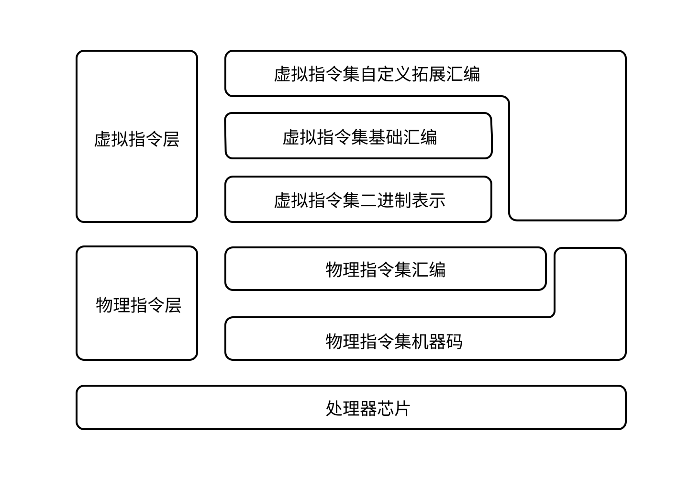

# 双层次CPU-GPGPU一体化指令集Vacuum

## 介绍
本项目是双层次CPU-GPGPU一体化指令集Vacuum的规范以及手册。双层次指令集是一种ISA（指令集架构）的设计理念，这种理念可以用于GPGPU的ISA设计，也可以用于CPU的ISA的设计。世界上最著名的双层次ISA,英伟达公司的PTX/SASS，就是一个纯粹的GPU的指令集。但是实际上双层次指令集可以做的更多，同一个双层次指令集可以在ISA层面上同时作为CPU和GPGPU的指令集，这是传统的单抽象层指令集很难做到的事情，也正是Vaccum可以做到的事情。

### 更新说明

本项目由爱好者，不定期更新，目前处在建设状态，还不能正式投入使用。

### 开源许可协议

本项目的许可协议是CC BY-ND 4.0 详见LICENSE文件。它有大概三个核心特征

1. 必须保留原作者署名信息；

2. 禁止对本指令集的核心规范（包括但不限于指令定义、寄存器结构、操作码等）进行修改、改编或衍生；

3. 允许自由使用、复制、分发本规范（商业/非商业场景均可），但不得基于本规范创建衍生版本。

换言之，Vaccum指令集作为一种开源的规范，使用者可以自由的使用，但是却不能自由的更改。

### git项目架构  

#### 指令集规范

所有的实现和规范都在spec目录下。

#### 手册

所有相关的手册都在docs目录下。

#### 图片

手册和说明的markdown文档中用到的图片在graph目录下

## 项目序言 什么是双层次ISA系统，为什么是双层次ISA系统？

GPGPU像CPU一样也是通过执行二进制指令进行运算的数字电路，也需要具体的指令集。美国英伟达公司显然是GPU市场的王者，他们使用的指令集系统有一个非常特立独行，极度显著但是却又少有人仔细讨论的特征：那就是它有两个层次结构。

这两个层次结构分别是PTX和SASS 。我们平日的写的CUDA中的kernel 还有__device__函数首先会编译到PTX汇编，但是英伟达的设备无法直接执行PTX，它所能直接执行的代码是SASS。所以设备的驱动和编译器会选择一个时间将PTX转化成SASS进而执行。转化的时间并不确定。他可能是发布时，安装时，或者运行时的编译。

PTX对社会公开，有着精细的指令集手册。然而SASS常常是英伟达公司的秘密。PTX虽然也会有版本更新，但是总的来看，大部分时候只是一些细节的更新，总体上比较稳定。然而SASS却可以随心所欲的变化。在我们为本项目的主角，双层次指令集是什么下一个严格的定义之前，我么先具体的考察英伟达的这种设计有什么好处？

### PTX/SASS系统的优越性

好处是显而易见的。ISA是硬件和软件的接口。要受到向上的软件系统和向下的硬件两个方向的指标考核。好的指令集除了在向下的硬件实现上应当方便简洁高性能易扩展易更改易实现，向上的软件接口处也需要满足足够的通用性和兼容性和易用性。然而向上和向下的两个指标时时处处打架，根本矛盾。双层次指令集是缓解向上和向下两种指标矛盾的银弹。

我可以举很多具体的例子来说明这这种矛盾的存在。并且讲解双层次指令集是如何解决这些矛盾。

#### 通用性要求引发的问题
我们首先通过一个虚构的场景讲述对指令集的通用性要求引发的矛盾。你可以想象你准备销售一款服务器CPU。服务器CPU有两种主要用户，1互联网企业买来做网站后端服务器；2科研机构买来做超级计算机。那么很自然，一些额外的浮点功能比如双精度浮点初等函数很受后者欢迎，一些字符串处理指令比如十进制运算受前者欢迎。那么要不要把这两种功能加进产品中呢？（请注意到如果你把相应的功能加入处理器，那么你必须在指令集中提供相应的指令，不然软件无法使用芯片功能，反过来如果指令集提供了相应的指令，那么芯片必须提供相应功能。）所以你有3种选择，第一同时在指令集和芯片上支持这两种功能，代价是增大很多芯片面积，一种用户至多只能用到你提供的额外功能的一部分。第二，什么也不做，只提供最基本的指令集和最通用的CPU功能。这样通用性和简洁性最好，但是代价是面对某个具体的领域，芯片的性能可能显著的不如提供了相应功能的竞争对手。第三，提供多个指令集和多个不同款的芯片。这样既不用额外的增大无用的芯片面积，也有很好的性能。代价是你的指令集生态就此破碎，上层软件的开发麻烦了不少。我们把上述三种选择简称为全都要，全舍弃，以及破碎指令集。

通用性要求引发的现实矛盾不仅仅在我上述的虚构场景中存在，现实中也确实存在。众所周知服务器GPGPU和游戏图形显卡是不同的，前者往往要求双精度算力，后者则会有很多专用的图形模块。如果一个厂商同时存在于服务器GPGPU和游戏图形显卡两个市场，那么似乎必须在全都要，全舍弃，以及破碎指令集三者都有缺陷的结果之间选择一个。但是，但是这个世界上有PTX/SASS这么一个神奇的东西，完美的回避了这种问题。双抽象层次指令集可以在面对这两种不同的GPU产品线的时候，可以有两种完全的不同的微架构，以及两种不同的下层指令集。但是这两种下层指令集共享了统一的上层指令集。上层指令集中既有图形相关指令也有双精度浮点指令。当上层指令集在一个底层设备上执行的时候，如果底层设备有双精度模块将上层的双精度指令翻译到底层的双精度指令，反之则用一系列通用的整数指令实现相应功能。这样上层指令所约定的功能就可以完整的被执行。指令集生态也保证了完整统一，所有的问题都消失了。

#### 兼容性要求引发的问题

我们接着讲兼容性引发的矛盾，这个问题在CPU的ISA中司空见惯，导致这类问题出现的原因很多。首先：人类的集成电路加工能力是在不断演化中，不同半导体制程下的最优设计很可能是不同的。最典型的CICS格式指令的出发点之一：如果可以用存储器地址当作操作数，就可以节省寄存器的数目。这种想法在今天很可笑，但是在集成电路工业早期，一个CPU可能只有几百上千个晶体管。并且存储器访问延迟和CPU内部运算延迟差距不大。所以用存储器地址当作操作数很有价值，也没啥问题；此外通过变换指令长度那么就可以节省宝贵的指令空间，所以这种设计也没啥问题。但是在超标量处理器微架构统治一切的今天，我们更倾向于认为：定长的指令方便对齐，进而方便解码；此外如果把存储器地址当作操作数那么就无法进行寄存器重命名，显著的对于指令级并行不利。昔日的最优设计到今天反而成了累赘。此外，随着半导体工业的发展，64位机器取代了32位。对于一个64位的机器而言支持32位程序并无任何性能上的好处，反而付出了面积成本功耗甚至性能上的代价。然而对于指令集中过时的设计我们无法抛弃它们，抛弃它们意味着我们放弃了过往的自己的指令集生态。这在ia64上有着血的的教训。我们今天看到所有主流的CPU商业指令集内部都有着大量的对性能无益处但是出于兼容性无法抛弃的东西。考虑到体系结构专家们对微架构的认识也是在不断演化的。我们无法设计一个性能上最优越的指令集并千秋万代之后还保证它的性能最优。必然要在性能实现的简洁性和前向兼容性中做出取舍。每一个设计集成电路的人肯定都不愿意看到指令集中的上古屎山，但又无可奈何。

但是对于双层次指令集而言这个问题接近不存在，因为硬件执行的下层指令不是软件的接口，它可以随着硬件设计师的心意随心变化。上层指令集保持前向兼容就可以，即使添加新的东西也不会伤害旧程序的兼容性。注意到性能指标是下层指令承担的，所以即使上层指令集不是那么优越，他不会影响硬件的性能，功耗和复杂性。

#### 厂商自定义指令带来的迁移和生态破碎问题
如果一个指令集有多个厂商共享，那么任何有企图心的集成电路设计商都会想向指令集中添加自己的东西。如果这种自定义是允许的，那么对于性能尤其是面对具体场景的性能很可能是有利的，但是自定义指令会导致指令生态的破碎以及迁移性的问题。

这个矛盾类似于通用性矛盾，也可以由双层指令解决。我们可以在上层指令中固定一些基本指令，任何一个厂商，比如厂商A在使用自定义指令的时候都要在相应的程序开头，给出这个自定义指令的基本指令实现。那么所有其他厂商可以在不修改自身编译器和底层指令的时候运行厂商A带有自定义上层指令的程序。至于给出自定义指令的厂商A,它可以在底层指令和硬件中直接实现自己的自定义指令。这样就同时保持生态的统一和自由。

### 双层次指令集的初步定义

粗略的讲，这种类似于PTX/SASS虚拟指令集和物理指令集的双层次系统构成的指令集架构就是双层次指令集架构。这种双层次的指令系统似乎有很多别的例子，比如说x86以及它的微码micro-ops，JAVA的字节码和具体的ISA,包括LLVM这样的中间层和某个具体的ISA之间都可以看作是虚拟指令集和物理指令集的双层次系统。那么似乎指令集的世界里这样双层次结构并不新奇，然而上述的三个例子和PTX-SASS这样的系统有显著的区别。

首先，x86向micro-ops的翻译是硬件主导的，额外占据的了相当的面积和复杂度，并且对性能有不利影响，这种东西更接近于一种被迫的补丁，是为了兼容历史包袱而做的妥协（CISC指令太复杂，硬件必须拆成微操作才能高效执行），而PTX→SASS的转换是主动的性能分工（上层保生态，下层追硬件极限）。前者是“不得不做的兼容”，后者是“刻意设计的协同”，这两种目的性的不同，导致了硬件复杂度的价值差异（x86的解码面积是负担，而英伟达的编译器+驱动转换逻辑是竞争力）。
而JAVA字节码更像是一种编程语言的中间件，而非体系结构的一部分。
至于LLVM-some ISA构成的双层次系统，确实更接近于PTX/SASS的关系，甚至英伟达介绍PTX的时候还拿LLVM作为一个例子来做比喻告诉你PTX是什么。但是它们是有一些核心差异的，就是PTX/SASS是一体设计的同一个体系结构系统的一部分。英伟达在设计新架构的SASS时，会同步规划PTX的接口扩展（比如Ampere架构的张量核心，PTX层面新增`mma`指令，SASS层面同步实现硬件加速）；而LLVM IR与具体ISA的关系是“单向适配”——LLVM不会为某款新CPU的ISA修改自身IR设计，CPU厂商也不会因为LLVM的特性调整ISA。这种“双向协同”vs“单向适配”，造成了灵活性的差距。举个例子，我们拥有了LLVM之后并不能随心所欲的更换ISA而没有代价，而SASS每代都可以依据硬件设计师的心意做出修改，并且几乎不付出代价。也许这种差异的根源在于没有CPU厂商公开指认LLVM就是自己的虚拟指令集，这一点很关键。LLVM本质是“编译器中间表示”，其设计目标是“适配所有ISA”，而非“为某个ISA服务”；而PTX的设计目标是“为SASS服务”，甚至可以说“PTX的存在就是为了让SASS能自由迭代”。这种定位差异导致：LLVM对ISA的“灵活性”是“兼容已有”，而SASS的“灵活性”是“创造新的”。

<figure>
  
  <figcaption>图1双层次指令集系统架构的原始结构。</figcaption>
</figure>

那么接着上述讨论，我们似乎可以为双层次指令集系统下一个原始的定义。它是主动设计的相互配合的由上层虚拟指令集和一系列下层物理指令集相互配合的指令集系统，其中虚拟指令集承担了面向软件侧的通用性兼容性等任务，而物理指令集则为了硬件实现的高性能而设计优化，两层指令集分工协作，追求系统指标的最优。这个定义听起来很合理，然而当我们为中央处理器设计一个双层次指令集的时候，我们会遇到一些本质的困难，这些困难会使迫使我们我们向这个双层次系统中添加新的东西。进而对双层次指令集系统产生新的理解，新的定义。

### 为中央处理器设计的双层次指令集系统

#### 伴随式编译解释器与伴随式编译解释器原语

虚拟指令集向物理指令集转化是所有双层次指令集系统绕不开的问题，它可以发布时，安装时，或者运行时编译，也可以运行时解释运行。运行时解释执行显然效率不高，发布时编译显然无法适配潜在的种类众多的低层次指令集。所以这两种方式至多只能作为补充。安装时编译显然看起来最简单并且性能也会很好，似乎是默认的主流解决方案。这种方案对于GPU系统似乎没什么问题，让驱动程序承担所有的转化职能就可以了。

相当多的运行在冯诺依曼架构的中央处理器上的很多程序都会在运行时修改自身，这样的程序被称为 “自修改程序”，包括安全加密程序，面向某个语言的运行时编译系统等等。自修改程序数量也许不多，但是它们的自修改功能往往无可替代。所以双层次指令集系统必须为这样的自修改行为提供支持。假定我们有一个运行在双层次指令集系统上的程序想要自我修改，它对自身的修改能力的实现当然依赖于双层指令集系统对它提供的支持。假定我们强制虚拟指令集向物理指令集转化是安装时一次性编译，那么它对自身虚拟指令层的代码无论怎么修改都无法真正实现运行时自修改。如果操作系统不支持写入程序段，那么这个程序就彻底失去了运行时改变自身的可能。如果操作系统不对代码段做保护，那么这个程序可以通过在运行时修改自己的物理指令层的代码来实现运行时自修改。然而这种修改行为显然违背了双层次指令集系统的设计初衷。因为双层次指令集系统中的虚拟指令和物理指令是一对多的关系，物理指令不仅数量众多还会随着时间推陈出新。如果这个程序想要运行在众多的具有不同物理指令集的硬件上，那么它需要主动为每一个物理指令集系统提供适配，有额外的巨大的工作量，而且这种适配工作不会停止，随着物理指令集的更新，无穷无尽的消耗着人力。如果放弃这种适配它只能运行在少数一些硬件上。

面对这种情景，我们显然需要一种为这种运行时修改自身的程序提供一些接口，让它们可以通过修改自身的虚拟指令集实现对自己的运行时修改。这些接口可以看作是虚拟指令集系统的一部分。自修改程序通过虚拟指令集修改自身后，依然面对着虚拟指令集向物理指令集转化的问题，解释执行，是以 “牺牲效率换灵活性和启动速度”，运行时编译（JIT）：以 “启动速度和内存为代价换长期效率”，两者在性能上无法互相替代，均需要得到虚拟指令集系统的支持。

假定我们有一个软件可以在客户机器上执行对双层次指令集的程序进行运行时，编译，安装时编译，以及解释执行。那么我们简称这个软件为伴随式编译解释器。(伴随的意思是它必须成为双层次指令集系统的一部分。)每一个新的物理指令集都需要一个新的伴随式编译解释器，因此构造它显然是新的物理指令集团队的工作的一部分。在客户系统中，伴随式编译解释器因为运行在硬件上，因此可以被认为也是通过物理指令集运行的程序。此外，按照前述，它的某些功能会被某些程序所调用，比如运行时修改自身的那些程序。因此它的（保持兼容性的）接口会被暴露在虚拟指令层。所以，当我们为中央处理器设计的双层次指令集系统时，我们需要把伴随式编译解释器当作它的一部分。

#### 伴随式微内核与其原语

CPU和GPU本质不同，GPU无论规模多大，技术多先进，严格来讲他都是一个IO设备，换言之CPU的从属，被CPU上的驱动程序所控制。对于GPU,中间层编译解释器的所有职能都可以一股脑丢给驱动程序，这个驱动程序可以由高级语言编写并且二进制的发布，然后交给CPU执行就好了。然而对于CPU，驱动CPU的驱动程序如果可以的话有另一个名字，操作系统。运行在双抽象层次指令集体系结构上的操作系统我们有理由相信他也是由上层层次指令编写的。他应该提供相应的中间层编译解释器的实现并且提供一个面向用户的接口。我们断言对于CPU上的中间层编译解释器而言它面对用户的接口必须成为上层指令集规范的一部分。否则它会伤害到程序的可移植性。这种规范技术上并不本质困难。但是阻止了我们将现有的某些中间表示IR，作为一个现成的双层次指令集上层指令的技术可能。

其次更难办的问题来了，操作系统最核心的内核有两个基本功能，内存虚拟化和调度。这两个功能都不是操作系统纯粹靠自身软件能解决的事情，必须谋求硬件或者说特权指令的协助。比如目前主流的内存虚拟化是段页式的，想要高效的完成虚拟地址向物理地址的转化，需要CPU提供TLB缓存加速这一过程。那么也需要指令集提供一些控制TLB缓存的指令给操作系统。我们可以把这些处理器和操作系统协作的指令称之为面向操作系统的指令。这些指令，操作系统厂商肯定希望是提供在高层次。否则，操作系统厂商就得为每一款不同下层指令的处理器更改自己的内核。如果提供在高层次。那么是否要固定这些指令不变呢？如果固定了这面向操作系统的指令不变那么就意味着其实固定了处理器和操作系统的交互方式。这就禁锢了操作系统和处理器本身的发展，违背了双层次指令集的初衷：可以无害的任意更改处理器实现。反过来如果这种指令是可以随着处理器厂商或者操作系统的发布者的心愿更改，那么它显然伤害了双层次指令集的另一个初衷：保持完美的通用性兼容性和可移植性。换言之上层指令应该规范功能，下层指令决定实现。但是面向操作系统的指令本身其实属于决定实现的东西，不是规范功能。所以很难把它们放在上层。

### 中央处理器-通用图形处理器两可的双层次指令集系统

