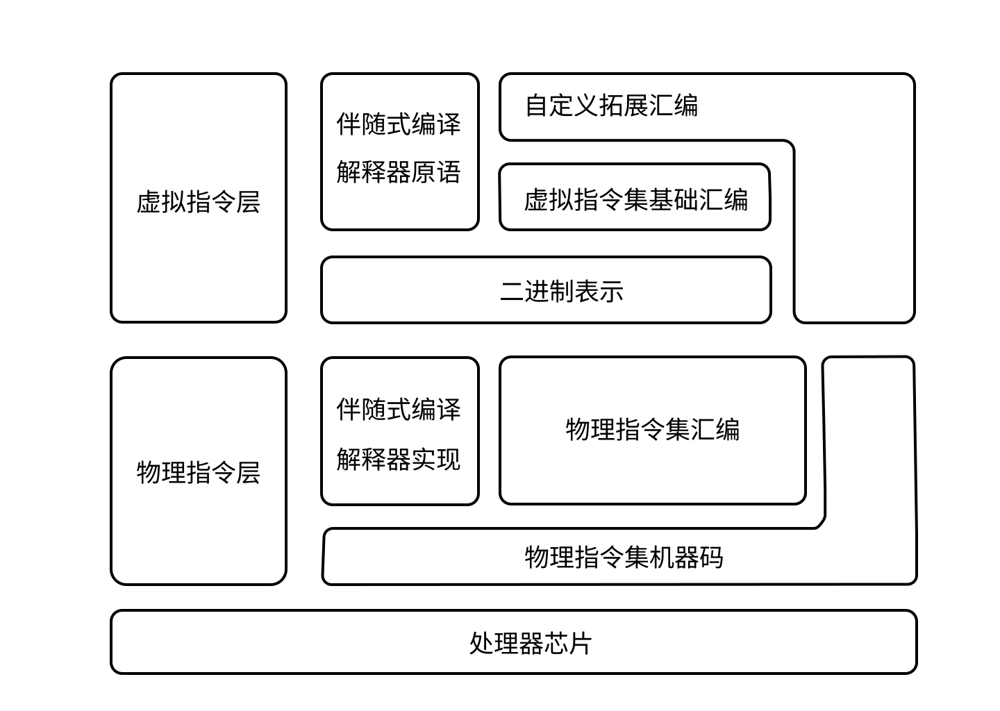
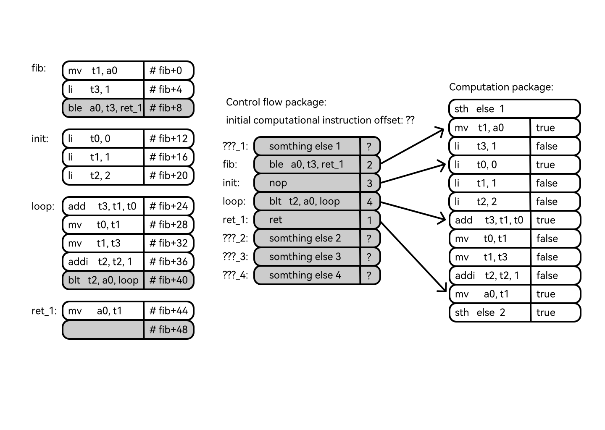

# 双层次CPU-GPGPU一体化指令集Vacuum

## 介绍

本项目是双层次CPU-GPGPU一体化指令集Vacuum的规范以及手册。双层次指令集是一种ISA（指令集架构）的设计理念，这种理念可以用于GPGPU的ISA设计，也可以用于CPU的ISA的设计。世界上最著名的双层次ISA,英伟达公司的PTX/SASS，就是一个纯粹的GPU的指令集。但是实际上双层次指令集可以做的更多，同一个双层次指令集可以在ISA层面上同时作为CPU和GPGPU的指令集，这是传统的单抽象层指令集很难做到的事情，也正是Vaccum做到的事情。

### 更新说明

本项目由爱好者，不定期更新，目前处在建设状态，还不能正式投入使用。

### 开源许可协议

本项目的许可协议是CC BY-ND 4.0 详见LICENSE文件。它有大概三个核心特征

1. 必须保留原作者署名信息；

2. 禁止对本指令集的核心规范（包括但不限于指令定义、寄存器结构、操作码等）进行修改、改编或衍生；

3. 允许自由使用、复制、分发本规范（商业/非商业场景均可），但不得基于本规范创建衍生版本。

换言之，Vaccum指令集作为一种开源的规范，使用者可以自由的使用，但是却不能自由的更改。这么做的目的是在于维护生态的统一。本项目仅仅涉及手册和规范，任何涉及到具体实现的工作（代码）会出现在另外的开源项目中。这些项目一般会使用非常宽松的开源许可比如MIT。

### git项目架构  

#### 指令集规范

所有的实现和规范都在spec目录下。

#### 手册

所有相关的手册都在docs目录下。

#### 图片

手册和说明的markdown文档中用到的图片在graph目录下

## 项目序言 什么是双层次ISA系统，为什么是双层次ISA系统？

GPGPU像CPU一样也是通过执行二进制指令进行运算的数字电路，也需要具体的指令集。美国英伟达公司显然是GPU市场的王者，他们使用的指令集系统有一个非常特立独行，极度显著但是却又少有人仔细讨论的特征：那就是它有两个层次结构。

这两个层次结构分别是PTX和SASS 。我们平日的写的CUDA中的kernel 还有__device__函数首先会编译到PTX汇编，但是英伟达的设备无法直接执行PTX，它所能直接执行的代码是SASS。所以设备的驱动和编译器会选择一个时间将PTX转化成SASS进而执行。转化的时间并不确定。他可能是发布时，安装时，或者运行时的编译。

PTX对社会公开，有着精细的指令集手册。然而SASS常常是英伟达公司半遮掩的秘密。PTX虽然也会有版本更新，但是总的来看，大部分时候只是一些细节的更新，总体上比较稳定。然而SASS却可以随心所欲的变化。在我们为本项目的主角，双层次指令集是什么下一个严格的定义之前，我么先具体的考察英伟达的这种设计有什么好处？

### PTX/SASS系统的优越性

好处是显而易见的。ISA是硬件和软件的接口。要受到向上的软件系统和向下的硬件两个方向的指标考核。好的指令集除了在向下的硬件实现上应当方便简洁高性能易扩展易更改易实现，向上的软件接口处也需要满足足够的通用性和兼容性和易用性。然而向上和向下的两个指标时时处处打架，根本矛盾。双层次指令集是缓解向上和向下两种指标矛盾的银弹。

我可以举很多具体的例子来说明这这种矛盾的存在。并且讲解双层次指令集是如何解决这些矛盾。

#### 通用性要求引发的问题
我们首先通过一个虚构的场景讲述对指令集的通用性要求引发的矛盾。你可以想象你准备销售一款服务器CPU。服务器CPU有两种主要用户，1互联网企业买来做网站后端服务器；2科研机构买来做超级计算机。那么很自然，一些额外的浮点功能比如双精度浮点初等函数很受后者欢迎，一些字符串处理指令亦或者十进制运算会受前者欢迎。那么要不要把这两种功能加进产品中呢？（请注意到如果你把相应的功能加入处理器，那么你必须在指令集中提供相应的指令，不然软件无法使用芯片功能，反过来如果指令集提供了相应的指令，那么芯片必须提供相应功能。）所以你有3种选择，第一同时在指令集和芯片上支持这两种功能，代价是增大很多芯片面积，一种用户至多只能用到你提供的额外功能的一部分。第二，什么也不做，只提供最基本的指令集和最通用的CPU功能。这样通用性和简洁性最好，但是代价是面对某个具体的领域，芯片的性能可能显著的不如提供了相应功能的竞争对手。第三，提供多个指令集和多个不同款的芯片。这样既不用额外的增大无用的芯片面积，也有很好的性能。代价是你的指令集生态就此破碎，上层软件的开发麻烦了不少。我们把上述三种选择简称为全都要，全舍弃，以及破碎指令集。

通用性要求引发的现实矛盾不仅仅在我上述的虚构场景中存在，现实中也确实存在。众所周知服务器GPGPU和游戏图形显卡是不同的，前者往往要求双精度算力，后者则会有很多专用的图形模块。如果一个厂商同时存在于服务器GPGPU和游戏图形显卡两个市场，那么似乎必须在全都要，全舍弃，以及破碎指令集三者都有缺陷的结果之间选择一个。但是，但是这个世界上有PTX/SASS这么一个神奇的东西，完美的回避了这种问题。双抽象层次指令集可以在面对这两种不同的GPU产品线的时候，可以有两种完全的不同的微架构，以及两种不同的下层指令集。但是这两种下层指令集共享了统一的上层指令集。上层指令集中既有图形相关指令也有双精度浮点指令。当上层指令集在一个底层设备上执行的时候，如果底层设备有双精度模块将上层的双精度指令翻译到底层的双精度指令，反之则用一系列通用的整数指令实现相应功能。这样上层指令所约定的功能就可以完整的被执行。指令集生态也保证了完整统一，所有的问题都消失了。

#### 兼容性要求引发的问题

我们接着讲兼容性引发的矛盾，这个问题在CPU的ISA中司空见惯，导致这类问题出现的原因很多。首先：人类的集成电路加工能力是在不断演化中，不同半导体制程下的最优设计很可能是不同的。最典型的CISC格式指令的出发点之一：如果可以用存储器地址当作操作数，就可以节省寄存器的数目。这种想法在今天很可笑，但是在集成电路工业早期，一个CPU可能只有几百上千个晶体管。并且存储器访问延迟和CPU内部运算延迟差距不大。所以用存储器地址当作操作数很有价值，也没啥问题；此外通过变换指令长度那么就可以节省宝贵的指令空间，所以这种设计也没啥问题。但是在超标量处理器微架构统治一切的今天，我们更倾向于认为：定长的指令方便对齐，进而方便解码；此外如果把存储器地址当作操作数那么就无法进行寄存器重命名，显著的对于指令级并行不利。昔日的最优设计到今天反而成了累赘。此外，随着半导体工业的发展，64位机器取代了32位。对于一个64位的机器而言支持32位程序并无任何性能上的好处，反而付出了面积成本功耗甚至性能上的代价。然而对于指令集中过时的设计我们无法抛弃它们，抛弃它们意味着我们放弃了过往的自己的指令集生态。这在ia64上有着血的的教训。我们今天看到所有主流的CPU商业指令集内部都有着大量的对性能无益处但是出于兼容性无法抛弃的东西。考虑到体系结构专家们对微架构的认识也是在不断演化的。我们无法设计一个性能上最优越的指令集并千秋万代之后还保证它的性能最优。必然要在性能实现的简洁性和前向兼容性中做出取舍。每一个设计集成电路的人肯定都不愿意看到指令集中的上古屎山，但又无可奈何。

但是对于双层次指令集而言这个问题接近不存在，因为硬件执行的下层指令不是软件的接口，它可以随着硬件设计师的心意随心变化。上层指令集保持前向兼容就可以，即使添加新的东西也不会伤害旧程序的兼容性。注意到性能指标是下层指令承担的，所以即使上层指令集不是那么优越，他不会影响硬件的性能，功耗和复杂性。

#### 厂商自定义指令带来的迁移和生态破碎问题

这个场景并非PTX/SASS面对的问题，双层次指令集系统可以为此场景提供一种银弹。

如果一个指令集有多个厂商共享，那么任何有企图心的集成电路设计商都会想向指令集中添加自己的东西。如果这种自定义是允许的，那么对于性能尤其是面对具体场景的性能很可能是有利的，但是自定义指令会导致指令生态的破碎以及迁移性的问题。产生了类似于上文中兼容性矛盾的问题。

我们可以在上层指令中固定一些基本指令，任何一个厂商，比如厂商A在使用自定义指令的时候都要在相应的程序开头，给出这个自定义指令的基本指令实现。那么所有其他厂商可以在不修改自身编译器和底层指令的时候运行厂商A带有自定义上层指令的程序。至于给出自定义指令的厂商A,它可以在底层指令和硬件中直接实现自己的自定义指令。这样就同时保持生态的统一和自由。

### 双层次指令集的初步定义

粗略的讲，这种类似于PTX/SASS虚拟指令集和物理指令集的双层次系统构成的指令集架构就是双层次指令集架构。这种双层次的指令系统似乎有很多别的例子，比如说x86以及它的微码micro-ops，JAVA的字节码和具体的ISA,包括LLVM这样的中间层和某个具体的ISA之间都可以看作是虚拟指令集和物理指令集的双层次系统。那么似乎指令集的世界里这样双层次结构并不新奇，然而上述的三个例子和PTX-SASS这样的系统有显著的区别。

首先，x86向micro-ops的翻译是硬件主导的，额外占据的了相当的面积和复杂度，并且对性能有不利影响，这种东西更接近于一种被迫的补丁，是为了兼容历史包袱而做的妥协（CISC指令太复杂，硬件必须拆成微操作才能高效执行），而PTX→SASS的转换是主动的性能分工（上层保生态，下层追硬件极限）。前者是“不得不做的兼容”，后者是“刻意设计的协同”，这两种目的性的不同，导致了硬件复杂度的价值差异（x86的解码面积是负担，而英伟达的编译器+驱动转换逻辑是竞争力）。
而JAVA字节码更像是一种编程语言的中间件，而非体系结构的一部分。
至于LLVM-some ISA构成的双层次系统，确实更接近于PTX/SASS的关系，甚至英伟达介绍PTX的时候还拿LLVM作为一个例子来做比喻告诉你PTX是什么。但是它们是有一些核心差异的，就是PTX/SASS是一体设计的同一个体系结构系统的一部分。英伟达在设计新架构的SASS时，会同步规划PTX的接口扩展（比如Ampere架构的张量核心，PTX层面新增`mma`指令，SASS层面同步实现硬件加速）；而LLVM IR与具体ISA的关系是“单向适配”——LLVM不会为某款新CPU的ISA修改自身IR设计，CPU厂商也不会因为LLVM的特性调整ISA。这种“双向协同”vs“单向适配”，造成了灵活性的差距。举个例子，我们拥有了LLVM之后并不能随心所欲的更换ISA而没有代价，而SASS每代都可以依据硬件设计师的心意做出修改，并且几乎不付出代价。也许这种差异的根源在于没有CPU厂商公开指认LLVM就是自己的虚拟指令集，这一点很关键。LLVM本质是“编译器中间表示”，其设计目标是“适配所有ISA”，而非“为某个单一的ISA服务”；而PTX的设计目标是“为SASS服务”，甚至可以说“PTX的存在就是为了让SASS能自由迭代”。这种定位差异导致：LLVM对ISA的“灵活性”是“兼容已有”，而SASS的“灵活性”是“创造新的”。

<figure>
  
  <figcaption>图1双层次指令集系统架构的原始结构。</figcaption>
</figure>

那么接着上述讨论，我们似乎可以为双层次指令集系统下一个原始的定义。它是主动设计的相互配合的由上层虚拟指令集和一系列下层物理指令集相互配合的指令集系统，其中虚拟指令集承担了面向软件侧的通用性兼容性等任务，而物理指令集则为了硬件实现的高性能而设计优化，两层指令集分工协作，可以在保持兼容性通用性的同时，任意更改处理器实现来保持代际或者面对窄场景的最优。这个定义听起来很合理，然而当我们为中央处理器设计一个双层次指令集的时候，我们会遇到一些本质的困难，这些困难会使迫使我们我们向这个双层次系统中添加新的东西。进而对双层次指令集系统产生新的理解，新的定义。

### 为中央处理器设计的双层次指令集系统

#### 伴随式编译解释器与伴随式编译解释器原语

虚拟指令集向物理指令集转化是所有双层次指令集系统绕不开的问题，它可以发布时，安装时，或者运行时编译，也可以运行时解释运行。运行时解释执行显然效率不高，发布时编译显然无法适配潜在的种类众多的低层次指令集。所以这两种方式至多只能作为补充。安装时编译显然看起来最简单并且性能也会很好，似乎是默认的主流解决方案。这种方案对于GPU系统似乎没什么问题，让驱动程序承担所有的转化职能就可以了。然而纯粹的安装时编译对于一个运行双层次指令集系统的中央处理器而言可能会造成额外的问题。

相当多的运行在冯诺依曼架构的中央处理器上的很多程序都会在运行时修改自身，这样的程序被称为 “自修改程序”，包括安全加密程序，面向某个语言的运行时编译系统等等。自修改程序数量也许不多，但是它们的自修改功能往往无可替代。所以双层次指令集系统必须为这样的自修改行为提供支持。假定我们有一个运行在双层次指令集系统上的程序想要自我修改，它对自身的修改能力的实现当然依赖于双层指令集系统对它提供的支持。假定我们强制虚拟指令集向物理指令集转化是安装时一次性编译，那么它对自身虚拟指令层的代码无论怎么修改都无法真正实现运行时自修改。如果操作系统不支持写入程序段，那么这个程序就彻底失去了运行时改变自身的可能。如果操作系统不对代码段做保护，那么这个程序可以通过在运行时修改自己的物理指令层的代码来实现运行时自修改。然而这种修改行为显然违背了双层次指令集系统的设计初衷。因为双层次指令集系统中的虚拟指令和物理指令是一对多的关系，物理指令不仅数量众多还会随着时间推陈出新。如果这个程序想要运行在众多的具有不同物理指令集的硬件上，那么它需要主动为每一个物理指令集系统提供适配，有额外的巨大的工作量，而且这种适配工作不会停止，随着物理指令集的更新，无穷无尽的消耗着人力。如果放弃这种适配它只能运行在少数一些硬件上。

面对这种情景，我们显然需要一种为这种运行时修改自身的程序提供一些接口，让它们可以通过修改自身的虚拟指令集实现对自己的运行时修改。这些接口可以看作是虚拟指令集系统的一部分。自修改程序通过虚拟指令集修改自身后，依然面对着虚拟指令集向物理指令集转化的问题选择解释执行，以 “牺牲效率换灵活性和启动速度”，或者运行时编译（JIT）：以 “启动速度和内存为代价换长期效率”，都是可行的。两者在性能上无法互相替代，均需要得到虚拟指令集系统的支持。并且虚拟指令层应当暴露相应的接口供运行时修改自身的程序调用。

假定我们有一个软件可以在客户机器上执行对双层次指令集的程序进行运行时，编译，安装时编译，以及解释执行。那么我们简称这个软件为伴随式编译解释器。(伴随的意思是它必须成为双层次指令集系统的一部分。)每一个新的物理指令集都需要一个新的伴随式编译解释器，因此构造它显然是新的物理指令集团队的工作的一部分。在客户系统中，伴随式编译解释器因为运行在硬件上，因此可以被认为也是通过物理指令集运行的程序。此外，按照前述，它的某些功能会被某些程序所调用，比如运行时修改自身的那些程序。因此它的（保持兼容性的）接口会被暴露在虚拟指令层。所以，当我们为中央处理器设计的双层次指令集系统时，我们需要把伴随式编译解释器当作它的一部分。虽然大部分程序依赖简洁高效的安装时编译即可，但是这种伴随式编译解释器很可能是运行双层次指令集系统的中央处理器系统的必须。

这种设计看上去在技术上并不本质困难，比如LLVM中就有类似的机制。理论上讲似乎是一个纯粹的工程问题，掌握了类似LLVM中使用的技术并且将它迁移至伴随式编译解释器上即可。但是其实并非如此，这是双层次指令集系统中最为精妙和困难的地方。Vacuum指令集拥有自己的伴随式编译解释器。

<figure>
  
  <figcaption>图2包含了伴随式编译解释器的双层次指令集系统。</figcaption>
</figure>

#### 伴随式微内核与其原语

CPU和GPU本质不同，GPU无论规模多大，技术多先进，严格来讲它都是一个IO设备，换言之CPU的从属，被CPU上的驱动程序所控制。对于GPU,中间层编译解释器的所有职能都可以一股脑丢给驱动程序，这个驱动程序可以由高级语言编写并且二进制的发布，然后交给CPU执行就好了。然而对于CPU，驱动CPU的驱动程序如果可以的话有另一个名字：操作系统。运行在双抽象层次指令集体系结构上的操作系统我们有理由相信他主要也是由虚拟指令编写的。

此时就出现了问题来，操作系统最核心的内核的很多基本功能比如内存虚拟化和调度，都不是操作系统纯粹靠自身软件能解决的事情，必须谋求硬件或者说特权指令的协助。比如目前主流的内存虚拟化方案是段页式的，操作系统想要高效的完成虚拟地址向物理地址的转化，需要CPU提供TLB缓存加速这一过程。那么也需要指令集提供一些控制TLB缓存的指令给操作系统。我们可以把这些处理器和操作系统协作的指令称之为面向操作系统的指令。我们如何在双层次指令集系统中安放这些指令？换言之双层次指令集系统如何与操作系统相互协同？

首先我们假定这种交互是通过特权指令进行的，操作系统厂商肯定希望是提供在虚拟层并固定这些指令不变。否则，操作系统厂商就得为具有每一款不同（物理）特权指令的处理器更改自己的内核，出现了类似自修改程序在上文中面对的困境，违背了双层次指令集的初衷：保持完美的通用性兼容性和可移植性。但是反过来，如果固定了面向操作系统的虚拟层特权指令不变，也将会产生缺陷。特权指令了钉死了处理器和操作系统的交互方式。这就禁锢了操作系统和处理器本身的发展与变革，尤其是操作系统作为独立的领域，我们很难期待一群体系结构的从业者能预判操作系统的未来发展。我们也没有能力固定一种操作系统与双层次指令集系统的交互方式并认为它也可以在千秋万代之后或者说横跨各个场景均能保持最优。它最终违背了双层次指令集的另一个初衷：可以无害的任意更改处理器实现。

这种问题的根源在于:虚拟指令应该规范功能，物理指令决定实现。但是面向操作系统的特权指令本身属于决定实现的东西，很难把它们放在虚拟层并且固定它们不变。面对这一个问题，我们有两种解决方案，第一种方案比较保守：在与操作系统交互或者说特权指令的领域，放弃双层次指令集的设计理念。特权指令提供在虚拟层并且可能随着版本的更新缓慢的改变；第二种方案非常非常激进，再向双层次指令集系统中加入一个新的模块：伴随式微内核以及其接口。伴随的意思同伴随式编译解释器相同，它必须成为双层次指令集系统的一部分。

伴随式微内核在虚拟指令集层提供了功能性的接口，这些接口有一些是用户程序直接可调用的比如在堆上管理内存的`malloc`,`free`，同步原语`barrier`，`lock`等等，还有一些则涉及特权程序（上层操作系统）的交互，比如管理进程的`fork`。物理层则负责提供这些接口的实现。在虚拟指令层并不规定操作系统的实现方式，比如虚拟内存是如何映射到物理内存的，或者线程是如何调度的。这种设计的目的依旧在于维持上层的兼容的时候任意的更改底层实现。但是随式微内核无法避免的规定某些概念的存在，比如虚拟内存和物理内存，比如线程与进程，这些概念一旦被定义就难以修改。但是也许令人感到安心的是这些概念也许可以被使用很久。

伴随式提供的接口应当仅仅涉及可能存在软硬件深度交互的操作系统功能，纯粹可以依赖软件达成的操作都应该留给操作系统的厂商。因此我们希望这个伴随式的内核尽可能地小，因此称之为微内核，但是它不一定满足学术界严格的微内核的定义。这种做法对于操作系统的厂商是双刃剑，一方面如果一个厂商愿意为双层次指令集系统编写新的操作系统，那么编写内核的负担转移到了提供双层次指令集的一方。另一方面，如果想要将已有的操作系统移植到某个具有伴随式微内核的双层次指令集上，那么这种伴随式微内核的设计可能是巨大的负面因素。即使乐观的想，这一移植工作需要动手屏蔽原始操作系统的内核的功能，并且解决潜在的冲突，有巨大的工作量。（亦或者将某个现有的操作系统改造成伴随式微内核的实现）。实践中移植旧的操作系统到Vacuum上是大概率是不可能的，因为它们的逻辑也许是相互冲突的。也许唯一实践上可行的操作是让伴随式微内核支持POSIX的接口，并且尽可能的兼容传统操作系统的用户代码。

伴随式微内核对于用户程序的性能，对于操作系统服务的性能有可能是利好。举个例子局部缓存寻址有四种方式：1(virtual tag, virtual index)，2(physical tag, virtual index)， 3(virtual tag, physical index)， 4(physical tag, physical index).理论上方案1最简洁性能最高，但是可能会面对重名问题，硬件解决重名问题会伤害性能。所以目前主流的方案是方案2。如果存在伴随式微内核，那么处理器的设计者就可以愉快的靠自身可以掌控的操作系统，用通过禁止进程内重名来规避问题，随后用上最简洁最高性能的设计（当然他也可以选择用回VIPT）。此外，对于某些程序高频使用的有可能能成为性能瓶颈的操作系统功能，比如在堆上管理内存的`malloc`,`free`。伴随式微内核的物理层实现是硬件设计团队给出的，可以通过软硬件协同设计的方式提高它们的性能。比如我们可以在每一个用户核心旁边放一个专门用于运行伴随式微内核的特化小核心，通过这两个核心的通信来完成这些系统功能。（作者的一个小小的远景就是在真空指令集上的malloc,free几乎在全场景追平用户自定义的内存池。）传统的操作系统厂商由于在上下游分工的问题，很难大量使用软硬件协同设计的手段提高自己的性能。

伴随式微内核应当在虚拟指令层提供关于安全的接口。但是它们的实现只能是物理层与硬件的设计者完成。采用高度协同的软硬件设计意味着安全性的上限更高，但也意味着将信任集中于单一实现体给出的安全黑盒。用户应充分了解这一权衡，并选择可信的实现供应商。

此外操作系统往往面临着和用户程序争抢资源的两难困境，如果操作系统的功能越强大，可能占据的硬件运行时间也就越多。对于先进的大规模中央处理器而言，分化出一些小核心专供操作系统使用，算是一种可能的解决方案。因为cpu的单核性能是数字集成电路的世界里面最昂贵的东西。很多时候设计者增大了一倍的晶体管数目，比如发射宽度从4到6，缓存数目翻倍，分支预测系统的缓存翻倍，最终导致的性能提升可能只有20%-30%。此外CPU的核心规模差距也非常大，提供一些小的核心给操作系统来释放用户的资源，也许是个合算的设计。Vacuum指令集并不强制实现者使用这种方案，但是为这种方案提供了虚拟指令集层的支持。

Vacuum指令集拥有自己的伴随式内核。选择这一激进方案的原因除了保持设计理念的完整之外，还为下文中提到的两可性的实现做基础。

<figure>
  
  <figcaption>图3：包含了伴随式编译解释器和伴随式微内核的双层次指令集系统。</figcaption>
</figure>

我们可以简单评估一下拥有伴随式软件栈的双层次指令集上的操作系统的设计。伴随式编译解释器其实必然会承担传统的链接加载器大部分的工作。伴随式微内核则承担了那些操作系统和处理器深度交互的那些职责以及分配内存
- 内存虚拟化
- 进程线程的创建和管理
- 多核心调度，
- 同步，
- 异常和中断

表面上看留给上层的操作系统实现的功能余下的是：
- Shell（命令行解释器）：用户交互入口。
- 文件系统（如 ext2、FAT、tmpfs 等）：无法持久化存储或加载程序。
- 设备驱动（磁盘、键盘、显示器、串口等）：无法与外部交互。
- 标准 I/O 接口（如 read/write 系统调用无后端实现）。
- 以及自身的加载机制。

换言之操作系统的被“与处理器交互深度”这一标准一分为二。但是这两部分的协作和交互还有很多问题需要被确定。我们分别称呼他们为上层OS和伴随式软件栈。Vacuum规定它上面运行的整个操作系统分为三层。其中两层属于上层OS。这两层分别是管理IO和文件系统以及总线的中间层，以及与用户交互决定操作交互的用户层。这种规定也决定了整个系统的特权级机制。用户层的特权级几乎和用户程序一致。微内核的特权级最高。但是系统的根权限可以分属中间层或者微内核层，此外伴随式软件栈和中间层的某些功能是降级运行的。

#### 伴随式微服务

编译器和编程语言的作者有时候也会面对一些两难困境，比如如何设计一个好的垃圾回收器，亦或者如何设计一个高性能的解释器。这些问题在软件层面没有银弹，但是硬件却可以为它们提供一些帮助。比如，曾经有的设计者试图设计一个硬件实现的JVM来降低JAVA解释器的开销。这种设计当然会达成目的，但是由于过于特化，在商业上可行性不高。双层次指令集系统可以提供面向这些问题的解决方案，我们称之为伴随式微服务。伴随式微服务的意思是它常驻核心并且与核心上的用户程序并行的执行。Vacuum的软硬件结合的预取器就是一种伴随式微服务。

<figure>
  
  <figcaption>图4：一种可能的运行双层次指令集的芯片结构示意图。</figcaption>
</figure>

### 中央处理器-通用图形处理器两可的双层次指令集系统

多核心中央处理器和通用图形处理器也许是数字集成电路世界中最重要的两种硬件，它们"几何上看处处不同，拓扑上看处处相同"。它们都是依赖指令进行运算的体系结构，因此都有解码器寄存器执行单元等等结构，都有片上缓存体系结构，都有片上网络等等组件。那么我们可以设计一种虚拟指令集，它可以通过不同的物理指令集和硬件设计，被选择性的实现为中央处理器或者通用图形处理器。具有这种功能的双层次指令集被称为两可式双层次指令集。Vacuum用到了三种东西实现两可能力，它们是1：谓词化的矢量指令；2：线程簇；3：线程簇私有存储域。通过对Vacuum对谓词化的矢量指令，从线程和线程私有存储域的不同硬件支持，我们用Vacuum指令集设计出中央处理器或者通用图形处理器。我们愿意为执行Vacuum的处理器提供一个新名字:IPU（Instruction processing unit）指令处理单元。

#### 谓词化矢量指令

通用图形处理器的核心功能是，加速那些拥有多数据同操作的任务，这种并行特征可以被成为SIMD。但是不同的通用图形处理器可以用不同的方式实现这一点，比如世界最大的通用图形处理器厂商提供的并行范式被称为SIMT或CTA。第二大通用图形处理器的厂商则依赖于谓词化的矢量指令，这种模式也被成为SIMD(注意和并行特征相区别)。中央处理器也常常会提供某些谓词化的SIMD能力，但是它与通用图形处理器有些区别，往往是通过定宽寄存器实现的。而通用图形处理器则往往规定同时操作元素的数目。Vacuum指令集的SIMD指令是后一种风格。Vacuum指令集并没有规定宽度（同时操纵的元素数目）。但是规定了宽度必须是4乘以2的正整数幂次或者零，不得超过机器字长。比如64位机器上可许宽度是0，8，16，32，64。Vacuum提供原语可以获得这一宽度和幂。

#### 线程簇

任意依据指令执行的硬件都面对一个问题，如何找到足够的指令来填满它的流水线？现代的高性能中央处理器的解决方案是乱序超标量，而通用图形处理器则主要依赖于多个PC协同工作。中央处理器，可以通过SMT（俗称的超线程）实现类似的东西。表面的区别是市场上常见的通用图形处理器的单个核心上（或者SM或者CU之类的等价称呼）的PC似乎更多，但是实际的在指令集层面区别在于通用图形处理器的这些同核心（SM或者CU或者什么别的称呼）上的同时驻留的线程（PC或者别的什么称呼），是可以显式的由用户程序控制和在用户程序控制下协作的。

Vacuum的伴随操作系统提供了线程簇的概念。线程簇的是一组线程，它们一般同时运行在同一个处理器核心上，操作系统在做任务调度的时候会把它们作为一个整体来看待，线程簇中的线程数目被称为簇宽度。单个核心可以同时运行的线程簇内的线程的数目被称为簇容量，它必须是2的正整数幂次或者1，不得超过机器字长。比如64位机器上可许宽度是1，2，4，8，16，32，64。Vacuum提供原语可以获得这一容量和幂。而在任意机器上用户可以发射的线程簇的簇宽度必须小于上述簇容量而且必须是二的幂次。例如一个物理指令集下，它的簇容量是8，每个核心可以同时容纳8个线程，那么用户发射的线程簇中可以有1，2，4，8个线程。在一个GPGPU风格的IPU上，簇容量可能很高比如64。在追求单核心算力CPU风格的IPU上，簇容量可能只有1或者2。Vacuum提供线程簇内专有同步原语，开销一般小于不同线程之间或者不同线程簇之间的同步。在CPU风格的硬件上，用户也可显式的使用线程簇来加速某些缺乏数据级并行潜力的任务。而且在CPU风格的IPU上，当程序员不显式的使用线程簇时。每个核心依然可运行数目等于簇容量个独立的线程，硬件并不一定会大量的浪费。

在Vacuum指令集中，每一个不是在线程簇内的单线程可以等价的是为一个宽度为1的簇。宽度为1的簇可以被称为普通线程。宽度为簇容量的簇被称为默认宽度簇。默认宽度簇和宽度为一的簇被称为受欢迎的簇。我们对程序员主动使用线程簇的建议是每一个线程簇的宽度设置为簇容量（默认簇宽度）。随后依据簇容量手动的划分任务。反之则应该使用普通线程。其它的簇宽度在一般情况下不建议使用。

线程簇不是实现两可性的唯一手段。还有一些别的路线比如说不对称的单核心上主线程与从线程组。为了追求主线程在核心上的单核性能，这样的不对称设计是Vacuum的最早期的想法。但是由于主从设计缺乏编程模型的简洁性与CPU-GPU的通用适配性，并且我们发现可以令线程簇的簇宽度和簇容量为1，最终我们选择了线程簇。

#### 线程簇私有存储域

通用图形处理器除了依赖每个核心都有的局部缓存系统之外，还存在程序员可以显式编程的片上存储器，比如世界第一大图形处理器厂商提供的和L1cache物理上相同的共享内存，第二大通用图形处理器厂商的LDS,GDS。Vacuum的伴随式内核定义的线程可以申请一块特殊的存储被称为线程私有存储域。在GPU风格的硬件上，这块区域可以映射到专门的硬件上，起到类似共享内存的作用；而在CPU风格的硬件上，访问线程私有存储域可能在硬件上和堆栈内存的访问没有什么不同，仅仅通过片上缓存体系进行加速而不依赖于特殊的硬件。一个CPU风格的程序完全可以忽略这一个概念。而CPU风格的IPU对这个存储域，可以不需要支付额外的晶体管，不用付出代价。

#### 两可性与性能

两可性对于编程的易用性和通用性和生态的统一有着巨大的价值。它并非意味着要追求一个既有强大并行化算力也有处理复杂串行逻辑与指令级并行的CPU-GPU一体化硬件核心（当然也非禁止这种设计出现）。硬件设计者在一般情景下可能依然选择设计一个处理数据级并行的GPU风格的IPU或者一个处理复杂逻辑任务的CPU风格的IPU。将一个处理复杂逻辑的任务运行在一个GPU风格的IPU上并没有速度保障，但是两可性可以保证它的功能完好，正确执行至程序结束。这也是任何双层次设计的初衷，在维持生态统一的同时允许各种风格的硬件实现。这些风格各异的硬件往往会为一大类或者一小类任务进行特化。将它目标范围外的程序运行在它上面并不保证一定执行速度很快。程序员应该有责任清楚这一点，应当对运行在不合适的硬件上的低性能有所预期（即使同一个PTX或者x86之下，硬件的能力也天差地远。难道过去的硬件就可以实现统一软件生态下性能可迁移吗？事实上性能可迁移就是一个理论上不可行的任务，软件生态统一就是人们能做得到极限了）。此外程序员应该明白自动并行和自动矢量化对于现有编译器而言依然是个挑战，所以发掘任务并行的能力的责任依然在程序员。这种对性能可迁移性的缺乏保证不能否定生态统一的价值。

加入设计者真的想设计一个纯粹GPU风格的IPU或者纯粹CPU风格的IPU。那么这种两可性的指令集会束缚硬件的性能发挥吗？作者个人推测，这种两可性对于硬件性能的正向和负向影响比较微弱。比如说可以设置簇容量为1，SIMD宽度为0，并且用伴随式编译解释器把簇内同步接口设置为空实现并且移出调用者对它们的调用，得到一个纯粹的CPU风格的处理器。它相比于传统的指令集，并没有提供额外类似SC一致性那样的特别不利的束缚（上层更弱的一致性规范在下层可以被增强，但是上层更强的一致性规范无法在下层削弱）。考虑到虚拟层只定义行为，而物理层才决定实现和性能。我们可以猜测虚拟层本身对性能并没有什么特别不利的影响。当它被设计成为一个GPU风格的IPU的时候，它的主要参数也可以设置为行业常见的默认实现。GPU常见的同步操作也几乎依照常见的风格进行复刻，甚至一些特殊的存储域都可以通过Vacuum强大的自定义功能在指令集中实现。最大的特色在于它的模型放弃了SIMT的束内多线程的机制，强制要求处理器的实现有一定的标量能力和标量寄存器存储，具体的大小取决于硬件厂商的投入的硬件规模。这对于很多任务可能是有利的。

在最终的产品中，很有可能CPU风格的IPU也会有一定的SIMD能力，但是只作为一个设计的次要附加功能而实现。它可能会比传统的CPU的SIMD能力更强，但是在面效和访存带宽等关键指标上远不如传统的GPU。而GPU风格的IPU产品有能力被当作一个核心数极多但是每个核心串行能力都很弱的中央处理使用。说不定会在数据库等默认是中央处理器的舞台上放出光芒。

# 其余主题

## 物理指令集不对称多处理系统

世界上有很多商品CPU,它们内部存在着核显。Vacuum作为具有两可性的指令集这件事意味着可以设计出一颗芯片，它上面的中央处理器核心和图形处理器核心都支持Vacuum指令集。然而这样的处理器它的两种核心的物理指令集很可能不同。此外如果一个存粹和CPU风格或者GPU风格的IPU上划分了专供操作系统运行的小核心的时候，这个小核心的物理指令集有可能与用户程序的核心不同。这就为伴随式编译解释器，伴随式操作系统，以及虚拟指令集本身带来了新的挑战。

## 为中央处理器设计的物理指令层

双层指令集系统破除通用性枷锁后，可以方便为特定负载优化的窄性能通用性的中央处理器的实现与商业化部署。然而中央处理器的商业价值之源在于通用性，作者个人认为，窄通用性中央处理器在我们这个时代很难成为市场的主角。在早期，作者不会将注意力投降这一领域。此外，双层指令集系统破除兼容性枷锁后，它对通用性的中央处理器性能释放是有利的（当然伴随式微内核也可以释放一些性能红利）。然而如何设计物理指令集以及相应的微架构使它的这种性能释放达到最大，是另外的相当非平凡的主题。作者个人认为这种性能提升的程度，决定了双层次指令集系统商业推广的潜力。

世界上已经有相当多的显式并行指令集以及设计理念，比如VLIW。这类指令集当然都可以成为双层指令集系统中的物理指令集，并且双层次指令集系统可以为显示并行指令集抹平低兼容性的显著缺陷。然而这些显式并行指令集以及它们的微架构实际上是单核性能的战败者，运行时信息的缺失是显式并行处理器指令级并行能力无法充分发挥的关键限制。个人认为这样的指令集可以成为某些注重面效的场合的优先选择，但是无法担纲成为物理指令集的主力。

寻找一个可以代表双层指令集系统冲刺单核性能极限的物理指令集（以及它的微架构），确实令人头秃。

作者从现有的乱序超标量的微架构处理器出发，找到一种物理指令集，暂时称之为离分式控制流图指令集（Split-Path Control-Flow Graph Instruction Set），简称为离分式指令集。这种指令集是为了带有分支预测乱序超标量微架构特化的指令集。或者粗暴的说“超标量微架构的专属指令集”。它走了一条显式并行微架构和乱序超标量微架构的中间道路，前者完全依赖软件进行指令级别并行，后者完全依赖硬件的动态调度。离分式指令集它如同乱序处理器，也依赖于硬件的动态调度，因此它可以有类似超标量的指令级并行的潜力。但是区别在于，它的指令集系统会为硬件的寄存器重命名，分支预测，单周期多发射等微架构行为提供传统指令集所不能的帮助。你可以将它看成一种为了乱序超标量微架构设计，灌满各种"语法糖"的指令集。它是软件帮助硬件，而非完全依赖软件或者硬件的调和路线。力求达到的目标是用简洁的设计可以实现一个宽，短，小的超标量微架构。宽是发射宽度大，短是流水线级数，和逻辑级数短，小则对应面积和功耗。

但是写下这一指令集和它的微架构显然是另一个项目，我甚至无法想象它的时间表。但是这个东西的存在性让我对Vacuum有了基本的信心,至少Vacuum这种设计理念确实有可能帮助到高通用性中央处理器的单核的性能与功耗指标。此外可以在本项目的末尾处简单的提及它的特征。

[fluct]
https://gitee.com/hao-yiping/fluctu

### 离分式控制流图指令集

注意这是一个简短的介绍，实际的实现可能会比本文档呈现的更复杂。总的而言它对前端设计的带来的改变更多，对于后端带来的改变较少。对于后端而言它和传统的超标量处理器的后端比较接近。虽然也会有一些新的机制与模块，比如快运算融合，巨型内分级第一级缓存，软件引导的硬件预取器等等。但是没有能力改变后端设计的主要结构。

#### 指令虚拟页与指令包

它的程序对应的全体指令按照指令虚拟页进行组织，每个指令虚拟页大小必须是2的幂，暂定为4kB。每一个指令虚拟页在虚拟内存空间中的首地址模4K后余数是0。换言之按4K对齐。指令虚拟页的概念和操作系统对内存的分页很像，但是概念和机制是独立的，前者是处理器架构中概念，后者是操作系统概念。指令虚拟页并不要求操作系统的内存虚拟化机制。如果一个分页式操作系统分页的单位是8K,那么放入两个指令虚拟页即可。即使是分段式的操作系统，段上放置虚拟页满足首地址对齐要求即可。

指令虚拟页中的指令按照指令包进行组织。指令包往往被设置为缓存行的大小，并且要求指令虚拟页的大小使它的整数倍。假定硬件的缓存行是64B。4kB指令虚拟页中可以存放64个指令包。指令包按自然按照自身的长度对齐。

#### 离分式的控制流图指令集

传统的指令集中的有两类指令，一种涉及到了PC的跳转，包括相对跳转绝对跳转，亦或条件分支和立即分支，这种指令有可能将PC值跳转到一个离当前值很远的地方。另外一种则是涉及到访存和计算，只要不出现异常，那么执行完这类指令后PC的值会线性增加指令的长度。我们把前一种指令称之为控制流指令，后一种称为计算指令。传统的指令集，无论是什么，控制流指令和计算指令都是交替混杂出现在程序中的。离分式指令集则不然，它讲所有控制流指令和计算指令在每个指令虚拟页中的存储位置分离，并且集中。指令虚拟页的低地址处放置控制流指令，高地址处放置计算指令。每个控制流指令包可打包8条控制流指令，每个计算指令包可打包16条计算指令（某些设计使用12条）。不能混合打包计算指令和控制流指令。

你可以想象编译器领域常用的控制流图，每个节点代表程序中的一个基本块（Basic Block）。 基本块是一段连续的代码，具有唯一的入口（第一行代码）和唯一的出口（最后一行代码），并且一旦进入该块，就会顺序执行其中的所有语句，不会中途跳转或被跳入。离分式指令集实际就是这种控制流图。每一条控制流指令拥有一些从属的计算指令，这些计算指令执行完后执行对应的控制流指令。离分式指令集假定了每一个控制流指令从属计算指令的数目上限比如64。并约定
 - 每一个控制流指令从属的全体计算指令处在同一个指令虚拟页中，并且地址连续。
 - 同一个控制流指令包的8条控制流指令从属的全体计算指令地址连续。用于压缩指令信息。
 - 指令包和指令虚拟页是用于对齐的要求，而不是用于填充。并不要求每一个计算指令包中包含的指令同属一个控制指令，也不假定它们从属的计算指令的数目，每一条计算指令都可以从属于不同的控制流指令。
 - 如控制流图一样，任何控制流指令的跳转对象只能是另一条控制流指令。不能跳转至私有的从属计算指令之间。
 - 从属计算指令可以通过异常来改变执行路径。
 - 可以使用两个PC或者用一个64bit的PC打包处理器的执行状态。
 - 每一个控制流指令从属的计算指令数目没有下限，可以是0或者1
 

 <figure>
  
  <figcaption>图5：以斐波那契数列计算为例展示离分式控制流图指令集的指令组织方式。</figcaption>
</figure>

离分式设计不是这种显式的控制流图指令集的唯一实现。

#### 离分式指令集下的局部缓存

离分式指令集对应的微架构本身有一个显著的特点是。它有两个物理上独立的第一级指令缓存，分别位于流水线的不同位置。其中一个存放控制流指令不妨称为L1IF，另外一个存放运算指令不妨称为L1IC。

指令系统必须有弱一致性memory consisitency 微架构系统必须有更弱的cache coherence，否则对性能有巨幅伤害。离分式指令集的某些关键机制依赖这些弱的一致性协议。

在双层次指令集下，伴随式微内核禁止进程内的物理地址的某些重命名实现对第一级缓存的纯粹虚拟寻址。请注意两个关键的地方：禁止进程内重名和禁止进程间重名对功能的灵活性损失完全不同，此外只有那些引起VIVT冲突的重名会被禁止。禁止进程内重名这种做法会对某些系统组件的功能需求显著的不利，但是对于用户代码影响相对较少。功能的缺失无法用性能弥补，需要伴随式微内核的一些功能机制补偿，比如程序员显控式段机制（Programmer-Explicitly Controlled Segment Mechanism, PECSM）。相较于传统主流方案的并行访存和虚实转化的VIPT设计而言VIVT有三个优势
- 大幅降低了功耗。一般的L1级别TLB是32路组相关的，并行的查找和比较这么多条目，并且舍弃查到的全部Tag中的大部分是对功耗相当不利的。
- 此外VIVT解开了对于第一级缓存容量的束缚可以用低的组相关实现大容量。
- 由于访问L2的延迟压力较小，L1-L2之间的TLB的容量可以显著的更大。所以稀疏的存储访问中，VIPT第一级缓存TLB缺失造成延迟的问题也大幅度缓解。
- 对于一个具有一定两可性并且有分页内存虚拟化机制的微架构，VIVT帮助巨大，如果在一个周期内发射32或者64个访存要求，那么将它们同时使用TLB进行虚实地址转换而言是困难的。

此外它有另一个显著的特点，它将L2的容量大幅度分散进入了L1缓存之中，形成了独特的内部分级的第一级exclusive（更有可能是Tag Inclusice Data Exclusive）梯次型缓存。传统的微架构中第一级缓存的容量比第二级小很多,比如第一级数据缓存32KB，第二级缓存1MB。但是离分式指令集的微架构不是这样的，举个例子它的第一级数据缓存L1D可能有512KB之巨，而L2可能只有64KB，或者每四个核心共享512KB的L2。如此巨大的L1D显然无法在一个合适的时序中访问它的全局。所以内部必然存在分级的设计。比如它有一个32KB的第一级L1D1和128-32 = 96KB的第二级L1D2，以及512-128 = 384KB的第三级L1D3。访问第一级可能要两个周期，第二级是三个，第三级是五个，此外更高内部级别的第一级缓存的物理设计可能偏向功耗与密度而非时延与带宽。这种分级内部是data exclusive的，访问第二级命中后会把第二级缓存行和第一级某个缓存行交换。这种设计的必要性来源于对指令缓存的容量需求。但是它本身对于整体的局部缓存的性能的总体影响未必是负面的。比如可以把缓存容量做到每级对应的时序约束下的最大。

这种梯次型的L1设计某种意义上是Vacuum这样的系统的专属：传统的微架构需要在L2层面把局域的哈弗结构恢复到全局的冯诺依曼结构。离分式指令集可以依赖伴随式微内核和专属指令来做这些。此外一个inclusive的巨型L2对于帮助强的memory consisitency指令集（SC/TSO）实现缓存一致性很有意义，离分式指令集的微架构也不需要这些。所以它的L2也可以是exclusive的并且容量分散进L1来追求更低的局部访存时延。更进一步的VIPT设计本身也对L1的内部再分级是一种挑战。这种巨型分级L1的设计，并不禁止设计者额外加上一个巨型的L2来进一步降低missing rate。但是这么做显然会大幅度提高成本。折衷的方案是使用四核心公用的256KB-512KB的L2。这也符合vacuum指令集中二级簇的概念。程序员可以发射四个线程簇到四个核心构成的二级簇上。

L2缓存则可以是存储物理寻址PIPT的。虚实转换发生在一二级缓存之间。此时更宽裕的时序约束使得引入更大容量的TLB成为可能。

由于控制流指令和计算指令分离存储并且有着严格的跳转约束和对齐约束。所以离分式指令集的微架构可以用前所未有的强度对指令本身进行预解码。这种预解码器的位置在L1I与L2之间，所以这种微架构对于L1I的容量有更高要求，考虑到流水线更短以及指令缓存本身有两个的事实，对于L1I的时序的要求也会更高。在双高之下，对内部再分级的第一级缓存可能成为刚性需求。

#### 离分式指令集下的栈空间

离分式指令集它对每一个线程实际上分配了三个栈不同的空间，分别称为堆中栈，寄存器保存栈，和控制流栈。堆中栈更接近于传统的栈的概念，程序员可见，通过访存指令访问。是和传统的栈不同的是，它保存寄存器和控制流的功能各自被剥离了出去。用于简化硬件和提高性能。寄存器保存栈，和控制流栈对程序员隐形，操作系统保护不可通过访存指令访问并且按8byte对齐。这种设计最大的缺点是对于小线程，需要额外的数个虚拟页和物理页，浪费了一定虚拟和物理空间。

控制流栈在L1IF的附近会有一个面积很小的硬件模块，不妨称之为控制流栈缓存。独立的控制流栈可以替代传统的用于分支预测的RAS缓存和代替传统硬件保护控制流的影子堆栈功能。它的地址严格准确并且是全体返回地址的局部缓存，设计者不需要考虑传统RAS类似的3C问题。控制流栈缓存通常包含几十到上百个条目。

寄存器保存栈在流水线的后端有对应的硬件模块。强化寄存器换入换出的延迟和带宽。通常包含几十到两百个条目。

#### 离分式指令集下的分支预测

离分式指令集的控制流指令平均占据64bit，比传统的任何指令集都重。这么做只为了在指令中间开辟一段空间存储一种特殊的信息。这段信息称为指令注释，指令注释用于存储分支预测信息。指令注释用于硬件在运行时动态的向指令本身存储分支预测信息。对于立即数相对寻址的条件分支，指令注释存储历史信息，替代了传统PHT/BHR/CPHT等的硬件实现。对于寄存器寻址的立即分支而言，这个缓存用于存储对跳转地址的预测。

离分式对分支地址的预测是在预解码阶段完成的，跳转目标在预解码后会存储在预解码后指令中的独立字段，此外预解码器会预先计算立即数相对寻址的目标地址。因此传统架构中BTB存储的信息实际上也是预解码后指令注释的一部分。更严格的讲，所以离分式指令集微架构下的分支预测器不需要，至少是不需要独立的BTB等分支缓存。粗略的讲，它把传统设计中的大部分分支预测缓存的物理实现都分散进了L1IF中。

在缓存行被替换的时候，更新后的指令注释当然可以随着整个缓存行一起写回。这种做法会将整个存储器层次结构看成自己的分支预测缓存。这会引起很多变化。它对处理有关分支预测缓存3C问题有利。这种设计最大最显著的劣势就是后文中会分析的指令密度。

此外这种设计还有一个关键约束或者说劣势，传统的微架构的分支预测是基于PC的。通过流水线开头的PC值访问各个分支预测缓存后直接就可以进行分支预测。而离分式微架构做不到这一点，它的分支方向预测器需要看到(预解码后的)指令本身，换言之流水线的开头是PC和PC对应的当前指令。这似乎是一个重大不利，因为为了避免空泡，这要求分支预测和取指在一个周期内串行的运行结束，对时序要求过高。然而事实并非如此，只需要一个轻量级的的超量预取机制，就可以使分支预测和取指在一个周期里面并行的执行（只要缓存命中的话）：每次取指的时候会取当前指令的跳转目标指令和当前指令的下一条指令，并在同时并行的进行分支方向预测。注意完成预解码后的指令注释里面已经包含了跳转目标信息，因此看到预解码后的指令立即可以知道它的跳转地址。而不需要额外的运算。完成方向预测后丢弃跳转目标指令或者当前指令的下一条指令，并依照方向预测更新PC即可。但是对分支方向预测在一个周期内完成的约束仍在。
 
分支预测需要当前指令信息这一点并非完全的负面影响，至少有两个非常正面的好处。
- 由于在开头就有当前指令的信息，所以对当前指令的其他操作，比如对它从属的运算指令的取指，或者将它压入控制流ROB中的操作都可以在这一个周期内并行的完成。（所以这个所谓的流水线的开头，与其称为开头，不如说是中央。）
- 编译器可以简单的告诉硬件当前指令的种类，比如来自一个循环抑或来自一个`if-else`。可以严格的而不是基于猜测的对于不同的种类的分支自然分配完全不同的预测策略。这种静态信息的写入对于编译器而言要远比写入静态的对于分支方向的预测要容易的多。

对于多核心处理器而言，如果不同的核心使用了同一个分支指令就会出现指令注释的冲突。我们称这种冲突为交火。交火对性能的影响可以是
- 正面的，在不同核心的分支情况接近和冷启动的情况下。
- 无影响的，在不同核心的分支情况接近和非冷启动的情况下。
- 负面的，在不同核心的分支情况不同和非冷启动的情况下。
总的而言是一个风险大于收益的情况。此时要求处理器使用弱一致性memory consisitency 和更弱的cache coherence。保证高频和当前分支预测信息的局部性。因为最频繁的分支必然会出现在局部缓存内，写回时更新全局缓存即可。此时交火仅可能发生在那些写回全局缓存或者从全局缓存取回的指令。

总而言之在这个微架构下用指令注释以及强预解码机制代替了大容量的分支预测缓存。并且将对目标地址的预测移出主流水线并且移至预解码阶段进行。分支预测需要看到当前指令本身这件事既是关键约束也是关键提升，使得它的前端的4-5种关键运算可以在一个周期内并行的完成。它的前端大约有三个周期，但是其中第二个和第三个周期是和后端功能重叠执行的。比传统的乱序超标量处理器短的多。

#### 离分式指令集下的寄存器重命名

在传统乱序超标量微架构中，当处理器同时发射多条指令（比如16条）时，硬件必须实时检查它们内部的数据依赖关系。
- 如果指令A在指令B之前，那么需要检查A的输出是否被指令B当作输入。如果是真，需要把A的目的寄存器传递给B而不是重命名表中即将被覆盖的旧的物理寄存器。
- 如果指令A在指令B之前，那么需要检查B指令的输出是否会覆盖A指令的输出。如果是真，那么不需要向寄存器重命名表递送A指令的物理地址。反之则需要。此外如果覆盖，同时发射的B指令之后的指令如果依赖B的结果，那么需要B指令的物理寄存器而不是被覆盖的A指令的。
这种对于内部检查的问题在于，检查所有指令对的依赖关系需要做随指令数目平方增加的大量计算，当超标量宽度增大后这会形成显著的对于功耗面积和时延的阻碍：16条指令要检查120对（16×15÷2），每对都需要一个独立的逻辑电路来比较。

离分式指令集在做了一些约束的时候可以做到极强的针对寄存器重命名的预解码。这些约束大致如下：同时发射的指令必须来自同一个控制流指令。此时可以将对于寄存器重命名中对于同时发射的多条指令内部数据依赖关系判断移出主流水线，移至预解码的部分。留在主流水线的寄存器重命名的主要部分，对于超标量宽度只有线性的面积复杂度和常数的时间复杂度（但是依然需要2N个N路选择器）。这一特性使得它只需要支付相对少量的代价就可以获得巨大的超标量宽度比如12-16。此外这一特性对缩短它的流水线的级数有利。

实现的具体机制大约如下，它每个包内有12-16Bit的编译器静态信息来标注这些指令是否与前一条指令同属一个控制流指令:预解码后，寄存器编码会增加一位，第一位处是增设的标志位。对于源操作数而言，如果标志位是0则说明指令包内无依赖，如果它是1则指出它依赖的是指令包内哪一条指令的结果。对于目的操作数而言，标志位是0则说明它的结果不会被包内后一条指令所覆盖。重命名时需要把重命名表中的逻辑寄存器分配给它。是1则相反、说明它会被后一条指令所覆盖，重命名时不需要把重命名表中的逻辑寄存器分配给它。此外还有一个重命名模块的设计红利就是它的对计算指令的重命名逻辑不需要考虑对控制流指令的处理。

如果每一个控制流从属的指令有很多个，那么这个设计没有什么原则上的困难。但是如果，一个控制流指令从属的指令数目很少，比如四个，那么它就有被分散在两个连续指令包中开头或者末尾的风险。简单的解决方案并没有灾难性的困难，比如
- 用第一个1bit来标注一个指令包的头四个指令是否和上一个指令包后几个指令同属一个控制流指令，如果是的话，对这四个指令实行双份的预解码。如果同时发射两个包，或者单独发射后一个包的时候用不同的预解码结果。
- 把第二个包与第一个包强制绑定，在访问这些分散指令的时候，只有这两个包同时缓存命中才会被认为是缓存命中。此时预解码第二个包的时候需要知道第一个包的信息，但是不需要存储两份不同的预解码结果。

一个典型的每周期发射一条控制流指令的离分式微架构等效的超标量宽度大约是1+12。看起来声势夺人，不过如果控制流指令提供的从属计算指令不足的话，比如平均只有四条从属计算指令情况下，它的运行中会产生大量的带宽浪费。好消息是它的带宽代价较低，浪费一些也无妨。现代超标量处理器支持同时处理多条控制流指令。对于控制流指令密集的任务而言，这种功能尤其重要。对于离分式指令集而言，前端同时处理两个控制流指令并无难度，通过增强超量预取机制即可。但是这种需求会对寄存器重命名处的预解码机制造成沉重的压力。使得它有回退到传统乱序超标量重命名机制的风险。但是对于控制流稀疏的任务亦或者是追求实现简洁的设计者而言，离分式指令集的微架构可以每周期仅仅处理一条控制流指令，此时它可以更极端的释放一种红利：寄存器重命名的预解码的结果本质上是一种在编译时期就可以轻易计算的静态信息。原则上可以直接编码这种结果在指令里，连平方复杂度的重命名预解码器都不再需要。

#### 指令密度粗估计

由于指令注释的影响，每一条控制路指令的长度为64bit。是传统精简指令集的两倍，此外每个数据指令包可能包含12或者16条指令。如果是16条每条32bit与精简指令集差距不大，但是如果是12条，那么每条计算指令的长度也比精简指令集更长。这两个不利因素造成了离分式控制流图的指令密度低的缺点。具体比传统精简指令集低多少取决于控制流指令的比例。不同类型的任务控制流指令的占比不同，控制流占比越高离分式控制流图的指令密度相比于传统指令集越低。我们取25%这样一个实践中遇到的相对高值。在每包16条计算指令的情况下，平均指令长度为5byte,比精简指令集长25%;在每包12条计算指令的情况下，平均指令长度为6byte，比精简指令集长50%。预解码后指令长度膨胀，计算指令大约膨胀1byte,控制流指令膨胀2byte。所以它对第一级指令缓存的利用效率大约只有精简指令集的50%-75%。至少几乎完全抵消了双物理L1I带来的额外容量优势。好消息是它本身可能不会带来剧烈的性能损失。此外分级L1设计本身可能有反过来带来一定的指令缓存容量和性能优势。所以反一般直觉的是，不必过于担心指令密度对局部缓存系统性能的影响。但是它会使得全局缓存，主存和非易失性存储的开销更大。

相较于VLIW而言，离分式控制流图指令集并不要求计算指令包中的指令从属于一个控制流指令，所以并不需要插入大量的NOP指令造成空泡。但是这并不意味着它没有空泡。
- 一个必然会遇到的空泡的来源是指令虚拟页。控制流指令和它的计算指令强制属于同一个虚拟指令页，那么向这个页填入指令的时候不太可能完全填满每一个指令包。每个虚拟指令页中都大概率会有一个计算指令包或者控制流指令包没有被填满。
- 编译器的某些可选激进优化可能会把热点内层循环所属的计算指令分配给一个独立的包。但是在大部分微架构上这么做没啥收益。
- 同理编译器的可选激进优化可能会倾向于把一个函数的所有指令装进一个虚拟指令页内。但是在大部分微架构上这么做没啥收益。

在没有定量数据的情况下上述的估计是非常粗糙的。未曾纳入估算的因素有：
- RISC指令集中常常有16bit的压缩指令。
- 离分式指令集单指令的功能可能更强。比如它的64bit的控制流指令基本可以做到单指令跳转至程序中任意地址，而且支持条件返回等功能。如果是12指令每包的计算指令，那么它的立即数更长，通用寄存器可能也有64个，对变量溢出到栈的额外指令需求更少，等等。

#### 离分式控制流图式指令集的编译器支持

为了实现离分式控制流图指令集，编译器需要做哪些额外的工作？作者可以笃定的说，需要做的工作量很少。它额外只要求编译器做一些编译器已经确定擅长的事情。作为离分式控制流图指令集它编码格式框架本质就是控制流图这一概念在ISA的直接映射。而控制流图自身本来是就是编译器最常用的中间表示形式。

编译器首先做完着色图寄存器分配接合和溢出后，将大部分的中间表示粗略的和物理指令集完成一一对应。接下来要做的就是把中间表示的控制流图的拆解。如果一个基本块中计算指令超过了离分式指令集编码上限，把它拆解成符合上限的多个基本块。其次，把这些基本块按顺序一一在指令虚拟页中分配位置。分配完毕后完成一一对应的翻译和静态信息标注即可。

需要静态标注的信息有：
- 分支的种类，比如是来自一个循环还是`if-else`，抑或一个循环会不会中途跳出。这些工作对于编译器而言几乎已经是必须做的工作，只是额外的要求把这个信息注释进指令而已。离分式指令集并不要求编译器静态预测分支的方向。与其静态预测，不如预运行一次程序。指令注释会依赖于实际情况将分支预测信息写回外存的。
- 控制流指令从属的计算指令的数目与地址。抑或是同一个控制流指令包内的从属指令的首地址。这对于编译器都是显然的。
- 一个计算指令包内的指令是否从属于同一个控制流指令。如果从属于同一个控制流，那么它的寄存器依赖关系如何？从属关系对于编译器也是显然的，依赖关系对于每一个指令包做一个遍历判断就可以了。这个判断的耗时指令包长度呈现平方关系对于指令包的数目线性复杂。由于指令包的长度一般不超过二十，而指令包的数目随代码量线性增长。这个判断对于编译器而言实际上是一个随程序大小线性增长的非常轻量级的任务。
- 把同一个函数分配到同一个虚拟页中对于缓存命中率没有额外好处，对于TLB命中率有可能有一定提升。但是VIVT下本来对于TLB的命中概率就很高。此外主要的好处是，立即数会和指令注释争抢空间，页内跳转的立即数可能比页间短一些。但是只要编译器顺序自然的排布指令，大部分的跳转都会落在页内。所以这个优化不是必做项。

#### 关于离分式控制流图指令集的一点感想

离分式控制流图指令集的是如何设计出来的？其实很多细节作者自己也不记得了，但是核心的理念是简化乱序超标量微架构的设计难度，硬件复杂性，晶体管规模和功耗的同时想办法提升（如果做不到提升至少做少不牺牲）它的性能。在有了离分式控制流图指令集和对它的微架构的设计草图后，作者对于历史上的指令集演进尤其是RISC和CISC之争有了一点自己的主观想法。

RISC诞生的时候很多人都相信它比CISC优越。但是最终的CISC经过多年发展后，这两者被认为差距不大。甚至很多人认为ISA是无关紧要的，微架构设计才是核心。但是实际上的真相可能是这样的：实际上而言ISA和微架构的关系极大，一个高效的计算系统的实现需要指令集和微架构的深度配合。RISC其实是”有大量通用寄存器的标量微架构“的原生指令集。可能对于在100万-1000万晶体管这个成本区间的标量处理器而言，RISC是比CISC甚至是任意其他种类的指令集优越很多的指令集。但是在进入了单核心晶体管突破了一亿甚至更多的乱序超标量的时代后。CISC/RISC都不是乱序超标量架构对应的原住民，它俩都要付出天文数字的晶体管作为支持乱序超标量这种微架构的代价，所以最终的表现差距大大的缩小了。乱序超标量是极度重要的微架构创新，统治了通用计算世界接近四十年。但是行业似乎并没想着为这种微架构寻找一种专属的指令集。而是转向了更激进的，对编译器和上层工具依赖更多的，而且最终失败了的VLIW/显式并行/数据流指令集等等尝试。换言之，乱序超标量微架构专属指令集这种概念在行业里面似乎是缺位的，所有人都默认它是一个不存在，不应该存在也不需要存在的东西。也正是因为缺了这种东西，所以大家最终形成的理念才会是指令集不重要微架构才是核心。我相信设计RISC的人，在设计RISC的时候的工作流程也是首先设计了一种微架构，它的核心特征包括了多个通用寄存器，有多级流水线等等。随后再寻找到了一种指令集，这种指令集在这种微架构上执行效率最高，这种指令集就是RISC。

从理论上讲，在核心参数比如指令发射宽度，物理寄存器规模，分支精度，局部缓存规模等等差不多的情况下，离分式控制流图指令集对应的微架构实现有可能比CISC/RISC更简单，而且支付的晶体管和功耗代价更少。但是这一切仅仅是没有定量数据支持的愿景和估算而已。作者也很好奇它的最终实现到底可以多么的小。如果对于同工艺同性能的传统的指令集的处理器而言，离分式控制流图指令集下的微架构确实可以做到晶体管规模和功耗小很多的话，那么上述观点应该是真的。否则上述观点不太正确，或者说乱序超标量微架构的专属指令集依然存在的，只不过作者设计的离分式控制流图指令集不配承担这一角色而已。

## Vacuum指令集的系统级编程语言

一个工作在中央处理器领域的体系结构团队，可以聚焦在指令集和微架构等传统体系结构研究对象本身。因为中央处理上运行的软件生态以及规范，比如Linux操作系统和C语言，都是可以复用也是无法更改的。此外CPU的通用性往往较好，一些硬件特征比如体系结构寄存器的数目无需向上层软件暴露。但是对于GPU不是这样的，对于一个为特定负载优化的处理器恐怕也不是这样的。

因此Vacuum指令集需要一个自己的系统级编程语言，Vacuum放弃了通过为了C++添加扩展的方式作为自己的系统级语言这一“最知名最成功”的策略。替代方案是两条腿同时走路：
- 设计一个对C语言的扩展来帮助传统的代码实现迁移。 
- 设计一个独立的新的系统级编程语言。

放弃为C++提供拓展的原因很直白，这个语言的前端开发工作量太大了。给它写一个带扩展的编译器前端的工作量可能等于选择的两个替代方案总合的数倍。（谁想写谁自己去写，作者自己没能力和精力）。选择为C语言的扩展来作为自己的系统级编程语言的动力也很直接，它最基础而且它写的库最能被广泛兼容并且开发工作量合理。

设计一个新的独立的系统级编程语言的动机则在于提供一个完全可以由Vacuum设计者掌握的语言，它可以和Vacuum同步演进深度协同，可以最大幅度的让开发者利用Vacuum的全部特征。这个语言的开发成本是可控的，因为Vacuum就是它在早期唯一支持的中间表示，所以只需要实现一个编译器前端和系统库就可以了。系统库的实现可以借用C语言的，亦或者要求一个运行在Vacuum上的操作系统来负责实现其中的一部分。此处我们不介绍它的具体理念与特点，仅仅介绍它作为Vacuum系统的一部分的设计理念：

- 它是一个复杂的多层次体系结构的一部分，不是新语言设计理念的试验田。所以它的核心机制应该参考C/C++经过验证的成熟实现。避免使用过于激进的和有争议的设计。比如作为一个系统级语言而言，作者没有能力拿掉指针这一概念甚至是void指针的概念。
- 它必然不是C/C++的一比一镜像。但是要求C++程序员能读完手册后立即上手。
- 如同Vacuum虚拟层是两可的一样，这个编程语言本身也是两可的。换言之作为一个整体，在模型与概念的层面模糊CPU和GPU的区别，CPU和GPU在这里仅仅是一些硬件参数不同的IPU。
- 它可以运行在一些传统的中央处理器上。但是在这些传统的中央处理器上不再扮演一个系统级语言的角色。在传统的中央处理器上，一些Vacuum功能向上层的暴露则应该用传统的处理器模拟实现。这种实现仅仅保证功能，并不保证性能和效率必然达到最优。并不保证所有的传统的中央处理器可以运行它，比如Vacuum强制约定了小端序，所以它大概率不可以运行在大端序上的传统处理器上。
- 对它在任何传统GPU设备上的可运行性不提供任何保证。
- 它可以为运行在IPU上的C/C++写库。它可以调用C/C++写的库。但这种调用可以不是一键编译默认达成的，而是需要额外的一份类似头文件一样的兼容性声明文件。
- 他应该在语法层和标准库层提供一些编译器前端自动器的某些功能对应的组件。并且假定Vacuum作为自己和这些组件的IR。它需要承担为形形色色的编程语言运行在Vacuum上所必须的编译器前端和解释器构造的工作。
- 大约LR(1)级别的前端足够分析它的文法。
- 它叫Yac。
  

[Yet Another C]
https://gitee.com/hao-yiping/YetAnotherC.git

## 一个现实世界中的Vacuum指令集的系统落地计划

看到Vacuum项目介绍的人的对项目第一反应大概率是对它落地的可能工作量之大表示震惊和质疑。尤其是它由爱好者主导开发的情况下。表面上看它的落地意味着大量全新组件的开发：两层指令集各自的规范，伴随式的编译器和伴随式微内核的软件开发，中间表示优化器，一个系统级编程语言yac等等。这些工作作为一个整体听起来犹如压顶泰山，但是开发一个最小可运行的vacuum指令集落地项目的劳动量远非表面看起来的骇人。且容作者辩解其中的诸多原因：
- 首先各个组件的相互配合其实可以削减相当数目的工作量，比如对于yac而言，vacuum就是它在早期天然的唯一中间表示，这意味着只需要开发这个语言的前端，就可以宣告这个语言的开发完成。它的标准库中的很多功能也可以直接通过映射到伴随式微内核的接口来实现。相应的工作量至少削减一个数量级。再比如传统中间表示优化器的需要做的很多功能在vacuum系列里面其实是伴随式编译解释器的工作。也能削减相当多的工作。实际上去除伴随式微内核和物理指令集规范，所有的软件工作加起来大约相当于一个新的语言的前端，中端，后端的工作。如果仅是一个大致能够运行，完成主要的性能优化的新语言而言，这几乎是一个单人能试一试的工作。
- 传统超大型软件硬件的很多复杂度来源于广泛的适配和沉重的历史包袱。比如LLVM和linux要支持十数种不同的ISA。然而Vacuum的特性天然使得它不需要考虑这些。它的伴随式软件栈只需要支持唯一的物理指令集和唯一的虚拟指令集。如果更新物理指令集，那么除了那些可以被复用的旧实现的代码之外，剩余的代码可以直接修改和抛弃。
- 为了每一个边缘场景优化到极致的系统和一个只完成主要性能优化的系统的开发工作量可能不是一个数量级。此外一个完成几乎全场景功能的系统，和一个仅仅完成主要功能的系统的开发成本也有显著差异。在落地第一个项目的时候，仅仅用考虑实现完备的功能和基本优化就可以了。
- 唯一的不确定性来源于伴随式微内核的开发。如果放弃将旧世界的一切尤其是Linux系统都移植到Vacuum上的想法之后。仅仅开发一个能跑，兼容部分POSIX标准的操作系统而言。按照过去的实践经验，一个完整的操作系统的工作量可以控制在一个新语言的前中后三端之下。
- 作为一个层次很明显的软件系统，定义了各层级的规范之后，可以容忍很多个团队并行且独立的实现各个层级的功能。
- 可以把Vacuum当作LLVM的后端。这两个东西的相互翻译站在能跑的标准之下原则上是比较容易的。

对于Vacuum软件栈的开发，开发者心态上应当把IPU当作一个不同于传统CPU和GPU的新系统的软件栈的开发。想着兼容旧世界的一切最终只会把它的方向拖入黑洞，选择性的做到一些性价比高的兼容就可以了。如果硬要与传统的事物类比，应该把Vacuum看成一个能做中央处理器的特殊GPGPU的ISA去理解，绝不能把它当一个新的CPU的ISA。就像开发一个新的GPU需要开发它的驱动，系统级编程工具，兼容一些旧的图形接口的逻辑类似。它的需要的操作系统和伴随式编译解释器也起到了类似GPU驱动的功能职责。传统的操作系统，比如Linux虽然很伟大，但是并不适合Vacuum。仅就不支持线程簇和线程簇私有存储域这一点，就足够将Vacuum的竞争力摧毁相当部分了。

为了落地Vacuum系统，首先需要落地一个CPU风格的IPU。因为在这个过程中可以完成一个完备的Vacuum的软件栈的开发。但是Vacuum系统如果能在某个领域实现商业竞争力，有可能是在GPU风格的IPU上为特定负载优化的窄性能通用性的处理器这样的边缘场景。这些场景，可能对兼容传统体系结构上软件栈的需求低。

如果它真的能够落地的话，一定会有一个扩圈的阶段来吸引对它的商业落地感兴趣的多方力量。但是在这之前:

对软件系统的开发也遵循阿姆达尔定律，有些部分是速度的瓶颈，无法通过增加人手解决。vacuum的第一瓶颈实际上是它虚拟层规范，它有着一旦实现更改代价高的特点。但是好消息是它作为一个规范而非实现本身，它的规模注定了不会过于庞大。大约是单人数月的劳动。随后，需要完成一个离分式CPU风格的IPU的物理指令集的实现。最后完成它的系统级编程语言Yac的前端。这几个工作大约是单人一年的劳动。离分式物理指令集是一个重要的展示示例，而Yac与它的前端则是另一个重要规范。完成这些后，在这个阶段就没有能力做出任何具体的开发规划了。

